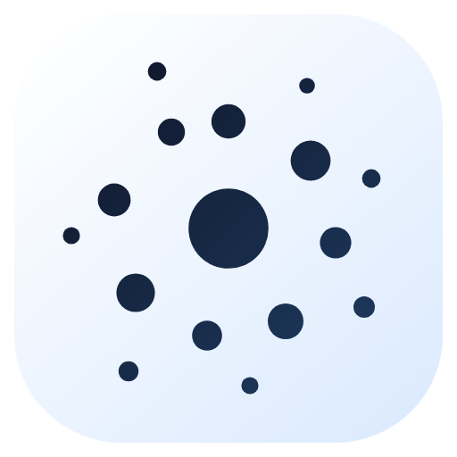
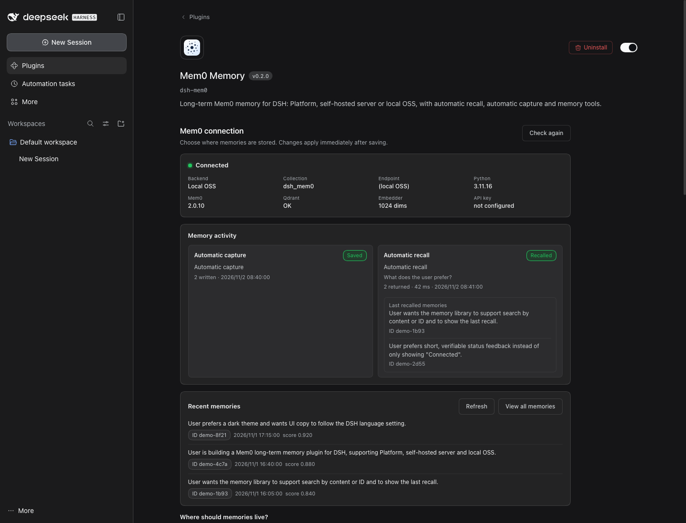
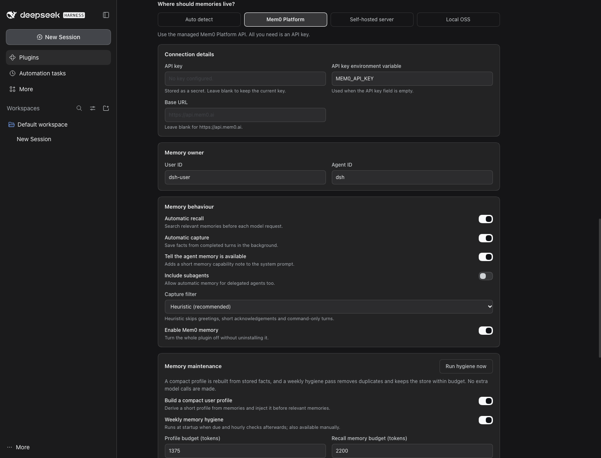
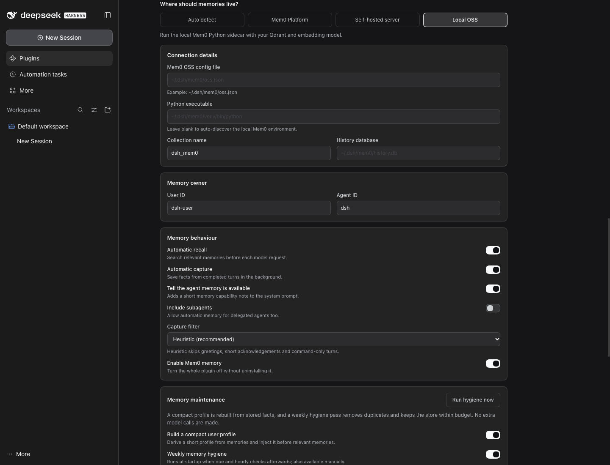
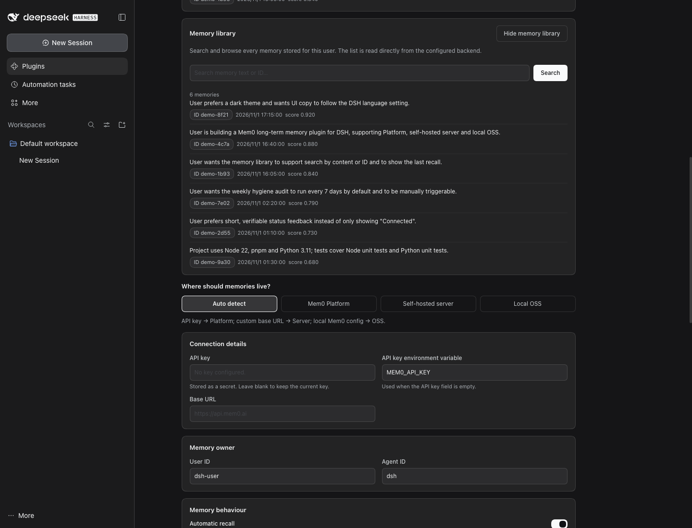
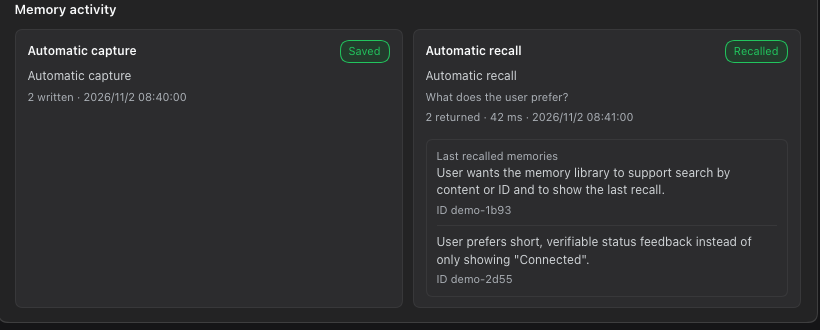
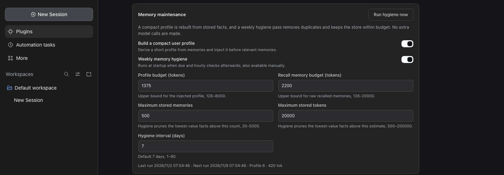
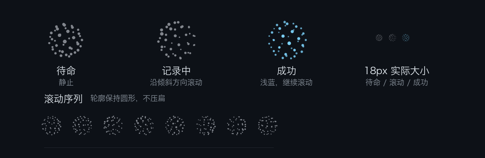
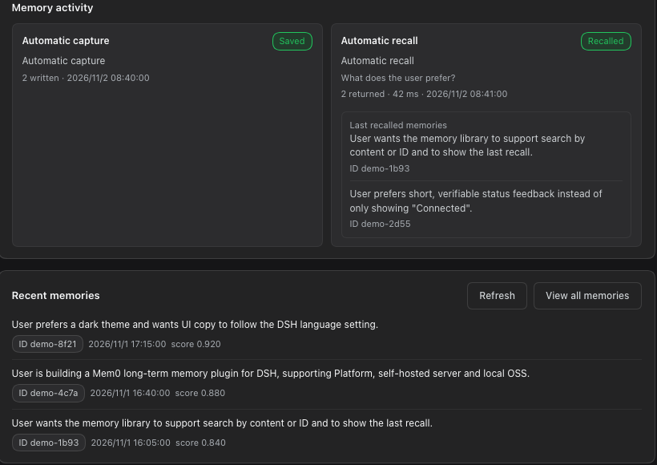
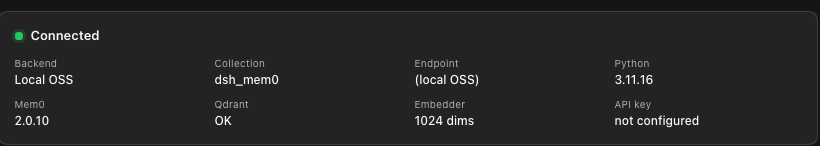

# DSH-Mem0

**English** | [简体中文](README.zh-CN.md)

<p align="center"></p>

A universal Mem0 long-term memory plugin for DeepSeek Harness (DSH).

Repository: <https://github.com/light-cheng/DSH-Mem0>

Three backends are supported:

- **Mem0 Platform**: the managed Mem0 API; only an API key is required, and it is the best fit for most users.
- **Self-hosted server**: connect to your own Mem0 REST service.
- **Local (OSS)**: memories in a SQLite file on this machine (`~/.dsh/mem0/memory.sqlite`), with your own embedding model (OpenAI-compatible server such as oMLX / LM Studio / vLLM, or Ollama) and extraction LLM. It is a native Node port of Mem0 2.2.1's add and search pipeline: no Python, no Qdrant, no extra service besides the two models.

## Features

- **Automatic recall**: on every turn, the latest real user message is used to search for related memories, injected into the model context as a `<mem0-relevant-memories>` data block. A failed or timed-out search never blocks the model request.
- **Automatic capture and filtering**: after a turn completes normally, the turn's user messages and the final assistant reply (not the intermediate narration between tool calls) are handed to Mem0 for fact extraction and storage, so long tool-heavy turns are still captured; interrupted, failed or rejected turns are not saved. The default heuristic filter skips greetings, short acknowledgements and command-only turns to reduce low-value memories.
- **Editable memory summary**: a structured summary is derived from stored memories, ranked by pinned/importance metadata and then freshness (newer facts first, decaying over roughly 90 days; text length only breaks ties), and injected before relevant memories. It has its own token budget, can be edited directly in the settings page, and can be read or rewritten by the agent through `mem0_profile_get` / `mem0_profile_update` / `mem0_profile_reset`. Manual edits survive weekly hygiene; **Rebuild from memories** restores the generated version.
- **Memory budgets and weekly hygiene**: recall memories and the profile each have a token budget; a memory hygiene pass runs every 7 days by default to deduplicate and prune the oldest over-budget memories. It only ever deletes memories written by this plugin (`metadata.source: "dsh"`), and automatic passes only preview until you confirm a manual run in the settings page.
- **Explicit tools**: `mem0_search`, `mem0_add`, `mem0_get`, `mem0_update`, `mem0_delete`, `mem0_status`, plus `mem0_profile_get`, `mem0_profile_update`, `mem0_profile_reset` for the memory summary.
- **Switchable backends**: Platform, self-hosted server and the local SQLite backend share the same tools and automatic memory logic.
- **Verifiable memory activity**: the settings page shows the last automatic capture / recall status and the most recently written memories (text, ID, time); it can open a **Memory library** to search every memory stored for the current user. **Last recalled memories** shows the texts that the most recent recall actually matched.
- **Foreground status icon**: below the chat composer there is a hollow globe made of dots of different sizes. It rolls along a tilted direction while automatic capture/recall is active, turns light blue and keeps rolling on success, and turns red on failure. The silhouette stays circular while rolling and never squashes. It uses dark dots in light themes and light dots in dark themes.
- **Bilingual UI and memory text**: labels follow DSH's language setting. With `translateMemories` on (off by default), stored memory text is translated into the page language with the current DSH model, cached, and falls back to the original text when no model is available.
- **Security boundaries**: the local backend opens no port and runs no extra process; common secrets are redacted before capture/recall; `mem0_status` never returns an API key.

## UI

After installation, open **Plugins** in the DSH sidebar and open **Mem0 Memory** under **Installed plugins**. You can choose a backend, inspect live connection status and save settings directly in the bundle detail page:




Each backend has its own fields and guidance:





The **Test connection** button calls the same read-only health check as `mem0_status`, showing the current backend, where memories are stored, the store / embedder / extraction LLM status, and never an API key.

**Memory summary** is the editable summary injected before relevant memories. It is shown as structured sections; use **Edit summary** to edit it and **Rebuild from memories** to regenerate it from the store. Manual edits survive weekly hygiene.

**Memory activity** records the latest automatic capture and recall results; **Recent memories** reads the backend directly and shows real memory text, ID and time. This makes it clear whether automatic capture actually worked. A capture that ran but wrote nothing (no memory added, updated or deleted) shows a grey **Nothing new** badge instead of the green **Saved**, and the composer status says **Nothing new to remember**. Platform and server answers that report no counts keep the **Saved** badge.

**View all memories** opens the **Memory library**, where every memory stored for the current user can be searched by content or ID. Memories this plugin wrote (`metadata.source = "dsh"`) have a **Delete** button. It first shows the memory's full text and ID and asks for confirmation; only then is that one memory deleted, its cached translation dropped and the list reloaded. Memories written by other apps or for another Mem0 user have no button, and the plugin's route (`DELETE /dsh-mem0/gui/memories?id=…`) refuses them with HTTP 403 and the reason. There is no bulk delete, clear-all or delete-by-filter. **Last recalled memories** shows the texts, IDs, count and latency of the most recent automatic recall:





The **Memory summary** card shows the editable, structured summary that is injected before relevant memories. Save a manual version or rebuild it from the store:


The **Memory maintenance** section lets you adjust the memory summary budget, recall budget, storage limits and hygiene interval, and shows the last/next hygiene time, the latest hygiene report (scanned, duplicates, pruned, deleted, failed, run time and trigger) and current memory size. **Run hygiene now** first computes a preview and asks you to confirm "delete N memories" before removing duplicates and over-budget memories written by this plugin; a manually edited memory summary is preserved.



The dot-matrix globe below the chat composer stays still while idle, rolls along a tilted direction while recording, and turns light blue and keeps rolling on success. The rolling animation uses a 3D projection, so the dot sphere keeps a circular silhouette and does not squash or deform; it stays still when the system requests reduced motion.



The actual status bar at the bottom of a conversation (cropped):




When **Test connection** succeeds, the status card shows a green **Connected** chip:



The UI follows DSH's language setting. When `translateMemories` is on (off by default, see [Privacy and data](#privacy-and-data)), the visible memory text, memory summary and recall preview are translated into the page language with the current DSH model; otherwise, or when translation is unavailable, the original text is shown. A Chinese screenshot is available in the [Chinese README](README.zh-CN.md).

## Memory maintenance

The **Memory maintenance** section separates several budgets that are easy to confuse:

- **Memory summary budget**: upper bound for the `<mem0-user-profile>` block, 1375 tokens by default.
- **Recall memory budget**: upper bound for the `<mem0-relevant-memories>` block, 2200 tokens by default.
- **Storage limits**: maximum number of memories (default 500) and estimated tokens (default 20000) retained after hygiene.

Hygiene runs every 7 days by default and can be set to 1–90 days. It runs once at plugin startup if due, then checks hourly. It deletes only duplicates and the oldest over-budget memories, and only among memories this plugin wrote (`metadata.source: "dsh"`, set by auto-capture and `mem0_add`). Memories written by other apps under the same `userId` are read into the summary but never deleted and do not count toward the storage limits. Until you have confirmed one manual **Run hygiene now**, automatic passes are dry runs: they write a report marked "Preview, nothing deleted" listing what would be deleted, and delete nothing. Each pass deletes at most 100 memories. The profile and hygiene history are stored in the current DSH profile's `dsh-mem0/maintenance.json`, not written back to Mem0. The latest report stays visible in the Memory maintenance card, including the scanned, duplicate, pruned, deleted and failed counts, run time and trigger; a manual **Run hygiene now** also returns the same counts.

**What hygiene deletes, and how a run is confirmed.**

- *Duplicates* are exact copies only: the full text after Unicode NFC, case folding and collapsing whitespace, compared by hash. Punctuation, digits and the end of long texts count, so `dose 1.5 mg` and `dose 15 mg` are different facts. Memories that only look alike (same text without punctuation, or the same first 240 characters) are listed as **suspected duplicates** in the report and never deleted.
- *A manual run is a preview plus a confirmation.* **Run hygiene now** first previews and gets a plan with a `planId` (valid for 15 minutes, in this plugin instance). Confirming sends that `planId` and an idempotency key, and is never retried automatically. It deletes only the plan's memories that still exist, are still this plugin's and are unchanged since the preview. The same plan runs once; a resend gets the first result back. After a reload or expiry, preview again.
- *The report counts what really happened.* The remaining count and the summary are the scanned store minus the deletes that succeeded. A preview's count is what would be left.
- *Everything is per memory store.* A store is the backend, its endpoint (no credentials; for OSS, `mem0ConfigPath`), the OSS collection, `userId` and `agentId`. The summary, the hygiene history and the deletion authorisation are kept per store in `maintenance.json`. After switching any of them, the old summary is not injected and automatic passes preview again until you confirm a run for the new store. A Platform or server account behind a different API key with the same endpoint and user is not told apart. On upgrade from an older `maintenance.json`, only a manual summary for the same user is kept; automatic passes preview again until the next confirmed run.
- *Stopping.* Disabling or reloading the plugin aborts the list and delete requests in flight; a running pass stops before its next delete and writes nothing more. A reloaded plugin waits for the old pass to stop.

**Deleting or editing a memory and the summary.** When a memory is deleted or updated (the `mem0_delete` / `mem0_update` tools or the library's **Delete**), a generated summary built from it stops being injected at once and is rebuilt in the background, also when hygiene is off. A manual summary is your text and keeps being injected; if it was edited from a generated summary that used the memory (or its sources are unknown), the Memory summary card says it may contain deleted or outdated content until you edit or rebuild it. Summaries are redacted like captures, before they are saved and again before they are injected, and the plugin's own block tags are removed from them. Recall and `mem0_search` queries are redacted the same way before they reach the backend or the activity view.

The generated memory summary uses local deterministic logic without extra model calls. Facts are grouped into sections by topic. You can edit it at any time; manual edits are stored in `maintenance.json` and are not overwritten by hygiene. Use **Rebuild from memories** to return to the generated version. Section headings follow the dominant language of the memories (Chinese when most facts are Chinese, English otherwise).

To keep DeepSeek's prefix cache warm, the summary is a system-prompt section (`plugin:dsh-mem0:profile`) that changes only when the stored summary changes. The per-turn `<mem0-relevant-memories>` block is a runtime context (`mem0:recall`), which DSH appends next to the latest user message, so it never rewrites earlier history.

## Working with context plugins

Context-management plugins (for example dsh-strata) can recognise what DSH-Mem0 injects by these names and tags. They are stable across releases; changing any of them is a breaking change, and `test/interop-contract.test.js` guards them.

| What | Where it goes | Name | Text starts / ends with | Changes |
|---|---|---|---|---|
| Memory summary | system-prompt section | `plugin:dsh-mem0:profile` | `<mem0-user-profile>` … `</mem0-user-profile>` | only when the stored summary changes |
| Recalled memories | runtime context, always last | `mem0:recall` | `<mem0-relevant-memories>` … `</mem0-relevant-memories>` | usually every turn |

- DSH joins all runtime contexts into one snapshot and appends it to history as a user-role message with `source.kind: "runtime-context"` whenever the joined text changes. Older snapshots stay in history, so their recall blocks are stale: a context plugin can trim or drop them without a model summary and without keeping the original, because Mem0 can recall again at any time. The newest snapshot should be left alone.
- The snapshot is not user input. Automatic capture only reads `user/message` events whose source is `user`, so recall blocks are never captured back into Mem0.
- Capture runs on `turn/end` from the text DSH-Mem0 buffered from that turn's events (the user messages and the final assistant reply). It does not read session history or tool output, so trimming history at the end of a turn, before or after capture, does not change what is saved.
- Memory text in a recall block has forged block tags removed, so each block contains exactly one opening and one closing tag.

### dsh-strata

With [dsh-strata](https://www.npmjs.com/package/@lightcheng/dsh-strata) installed, the two plugins follow a shared contract:

- **Shared recall budget.** Before each recall, DSH-Mem0 asks Strata's optional `strataBudget` service how many tokens the recall block may use this turn: the full `memoryBudgetTokens` normally, half once the context passes 65% (`tight`), and at most 512 tokens past 75% (`critical`). An allowance of 0 skips recall for that turn. The block is fitted with Strata's token counter, the same one its thresholds use. Without Strata, or if the service fails or returns something unusable, recall uses `memoryBudgetTokens` as before. The memory summary is never shrunk per turn: it sits in the cached system prompt, and changing it every turn would cost more than it saves. `mem0_status` and the Recent activity card show the last budget, e.g. `recall budget 1100 / 2200 (strata: tight)`.
- **Fold summaries as a memory source (`captureStrataFolds`, off by default).** When it is on, together with automatic capture, each first-level fold summary that Strata lands (`strata/fold-landed`, tier 1 only, main-agent sessions only) is redacted and saved through the same capture queue, with metadata `source: "dsh"`, `via: "dsh-strata"`, `fold`, `tier` and `session_id`, so hygiene treats it like any other capture. These are the same turns automatic capture already saved, a second time as a cleaner summary; Mem0's own inference merges repeated facts. Empty or low-value summaries are skipped. Recall blocks are never written to Strata's archive, and Strata drops stale recall snapshots instead of folding them.

## Architecture

```text
DSH Agent
  ├─ system-prompt/assemble ──┐
  ├─ session/event            ├─> Node plugin (index.js + lib/)
  ├─ mem0_* tools            ─┘        │
  │                                     ▼
  │                          backend adapter (one of)
  │                          ├─ Mem0RestClient (platform / server)
  │                          └─ Mem0NativeClient (oss)
  │                          (shared HTTP, timeouts, circuit breaker: lib/http.js)
  │                                     │
  │                     ┌───────────────┴──────────────┐
  │                     ▼                              ▼
  │          Mem0 Platform / server        SQLite store (node:sqlite, WAL)
  │                                        + your embedder + your LLM
```

## Installation

Install this directory through the DSH Plugin Manager (development/local install):

```text
plugin_manager action: install_bundle
target: <absolute path to this directory>
```

Or use the DSH CLI:

```bash
dsh plugin --profile desktop add link:"$(pwd)"
```

After the package is published to npm, install it by package name:

```bash
dsh plugin --profile desktop add dsh-mem0
```

If DSH reports `restart-required`, restart DSH before verifying.

> A local `link:` install makes DSH show the absolute checkout path under **Code source** in the plugin detail page. That is install metadata from the local profile, not part of the package. `npm pack` and registry installs contain no local paths; installing `dsh-mem0` from npm shows the package source instead. The published screenshots are captured so that this local-only row is not included.

## Configuration

After installation, configure it visually in **Plugins → Mem0 Memory** in the DSH sidebar (recommended); you can also write the profile's `cordis.patch.yml`. Full YAML example:

```yaml
- id: dsh-mem0
  name: dsh-mem0
  config:
    backend: platform
    apiKey: "your-platform-api-key"
    userId: "your-user-id"
    agentId: "dsh"
```

### Backend modes

#### Platform (simplest, recommended for new users)

```yaml
config:
  backend: platform
  apiKey: "your-platform-api-key"
  userId: "your-user-id"
```

The key does not have to be in the plugin config. Recommended: store it in DSH credentials (for example `~/.dsh/.credentials.yaml`), so it never appears in the profile config:

```yaml
version: 1
refs:
  MEM0_API_KEY: m0-your-key
```

and refer to it by name (this is the default):

```yaml
config:
  backend: platform
  apiKeyEnv: MEM0_API_KEY
```

Lookup order: a literal `apiKey` in the config, then DSH credentials for the name in `apiKeyEnv` (the store first, then the launching environment and `.env` files), then the environment variable of that name. With credentials, a rotated key applies on the next request without a restart. `mem0_status` reports where the key came from (`key source: config`, `credentials`, `env` or `none`), never the key.

> **Note on `backend: auto`:** if `MEM0_API_KEY` (or the name in `apiKeyEnv`) is stored in DSH credentials or set in DSH's environment, `auto` picks the cloud Platform even when a local OSS config exists. `mem0_status` and the settings page show why the backend was chosen ("backend choice"). Set `backend` explicitly if you want a specific one.

#### Self-hosted Mem0 server

```yaml
config:
  backend: server
  baseUrl: "http://127.0.0.1:8888"
  authType: apiKey
  apiKey: "your-server-key"
  userId: "your-user-id"
```

`authType` supports `apiKey` (`X-API-Key`), `bearer`, `token` and `none` (for local services with `AUTH_DISABLED=true`).

<a id="local-backend"></a>
#### Local backend (SQLite, no Python)

`backend: oss` keeps memories in one SQLite file, by default `~/.dsh/mem0/memory.sqlite` (Windows: `%USERPROFILE%\.dsh\mem0\memory.sqlite`). It uses `node:sqlite`, which is built into the Node that DSH ships (Node 24.9 or later); nothing is installed. You bring two models:

- an **embedding model**: any OpenAI-compatible `/embeddings` endpoint (oMLX, LM Studio, vLLM, OpenAI, …) or Ollama (`/api/embed`);
- an **extraction LLM**: any OpenAI-compatible `/chat/completions` endpoint (DeepSeek, a local gateway, …).

<a id="setup-wizard"></a>
**Setup wizard (recommended).** Settings page → Local OSS → **Local setup wizard**. Switching the backend to Local OSS checks first and offers the wizard when something is missing. The steps:

1. **Embedding model.** A cloud API first (any OpenAI-compatible `/embeddings`; suggestions: OpenAI `text-embedding-3-small`, SiliconFlow / Alibaba Cloud `bge-m3`-class models), or a local model: the wizard looks on `127.0.0.1` for Ollama (11434, 15434), LM Studio (1234) and, on macOS only, oMLX (8000), and lists their embedding models (bge-m3, 1024 dimensions, is the suggestion for Chinese and English). One test embedding gives the dimension.
2. **Extraction LLM.** Address, model, key; one test extraction with Mem0's prompt and a fixed sample, with advice on `max_tokens` (at least 8000 for reasoning models) and `reasoning_effort`.
3. **Memory file.** Checked writable and not on a network drive or a synced folder (iCloud, OneDrive, Dropbox, Google Drive, …), which damage SQLite files.
4. **Self-test and save.** A probe memory for the test user `dsh-mem0-wizard-selftest` is written, found and deleted, and nothing of that user may be left. Only then are keys stored in DSH credentials (`DSH_MEM0_EMBEDDER_API_KEY`, `DSH_MEM0_LLM_API_KEY` by default), the `dsh_mem0` block of `oss.json` written (the previous file is kept as `oss.json.bak-<time>`), and the local backend switched on. A failure changes nothing.
5. **Move memories from Qdrant** (only for earlier versions; see below).

The wizard probes nothing but `127.0.0.1`; an address you type is contacted only when you press a test button. If the embedder of the memory file changed, step 1 offers to recompute the vectors.

Or configure by hand in the `dsh_mem0` block of `~/.dsh/mem0/oss.json`, which DSH's settings sync never rewrites (see [examples/oss-config.example.json](examples/oss-config.example.json)):

```json
{
  "dsh_mem0": {
    "userId": "your-user-id",
    "embedderProvider": "openai",
    "embedderBaseUrl": "http://127.0.0.1:8000/v1",
    "embedderModel": "bge-m3",
    "embedderDims": 1024,
    "embedderApiKeyRef": "MEM0_EMBEDDER_API_KEY",
    "llmBaseUrl": "https://api.deepseek.com/v1",
    "llmModel": "deepseek-chat",
    "llmApiKeyRef": "MEM0_LLM_API_KEY"
  }
}
```

Keys are referenced by name (`embedderApiKeyRef`, `llmApiKeyRef`) and looked up in DSH credentials (`~/.dsh/.credentials.yaml`), then in the environment, on every request: they never sit in `oss.json` or the profile. An `oss.json` in Mem0's own format (`oss.embedder` / `oss.llm` with a literal `api_key`) still works as a fallback; the `oss.vector_store` block is ignored. The same fields can be set in the profile config; the profile wins over the `dsh_mem0` block, and a value equal to the default counts as not set.

| `dsh_mem0` key | Default | Meaning |
| --- | --- | --- |
| `storePath` | `~/.dsh/mem0/memory.sqlite` | The SQLite file |
| `embedderProvider` | `openai` | `openai` (any OpenAI-compatible server) or `ollama` |
| `embedderBaseUrl` | Ollama: `http://localhost:11434` | e.g. `http://127.0.0.1:8000/v1` |
| `embedderModel` | — | e.g. `bge-m3` |
| `embedderDims` | from the model | Sent as `dimensions` (OpenAI-compatible only) when set |
| `embedderApiKeyRef` | — | Credential name of the embedder key |
| `llmBaseUrl`, `llmModel`, `llmApiKeyRef` | — | The extraction LLM |
| `llmMaxTokens` | `8000` | Output budget of each extraction call (Mem0's own default is 2000; hybrid reasoning models spend part of it on thinking) |
| `llmTemperature` | `0` | Mem0 sends 0 (and `top_p` 0.1) |
| `llmReasoningEffort` | not sent | e.g. `"none"` to turn thinking off on gateways that support it |
| `userId`, `agentId`, `translateMemories`, `captureStrataFolds` | | Plugin settings, as in the table below |

**How it works.** Adds follow Mem0 2.2.1's V3 additive pipeline: the last 10 messages of the conversation scope, the 10 most similar memories, one LLM call with Mem0's own extraction prompt (copied verbatim, with "answer in the language of the input" on), then only ADD: new facts whose md5 matches an existing or another new fact are skipped. Adds of one user/agent run one after another. Search embeds the query, compares it with every stored vector (cosine, brute force; a few thousand memories take milliseconds) and drops scores below 0.1. Vectors are cached in memory; another DSH process writing the same file is noticed through SQLite's `data_version`. WAL mode and a 5 s busy timeout let several DSH profiles share the file. See [NOTICE](NOTICE) for what is derived from Mem0.

**Changing the embedding model.** The store remembers which embedder (model and dimension) wrote its vectors. With another one configured, recall and capture stop with a clear `EMBEDDER_MISMATCH` configuration error instead of mixing vectors. Switch back, or recompute the vectors with the new model (the setup wizard's **Recompute vectors**, step 1). An empty store simply takes the new embedder.

**Extraction failures.** When an answer is cut off (`finish_reason=length`), the capture is retried once with twice the output budget (up to 65536). An answer that is not JSON or empty is retried once; a refusal is not. A failed extraction records its `finish_reason`, output budget and token counts in the failure history and the Memory activity card (numbers only, never text). Extraction failures do not count toward the circuit breaker: the LLM answered, so pausing memory would not help.

**Errors.** SQLite errors are attributed to the vector store with a short code: `busy` (another process held the file too long; retried with the next call), `readonly`, `corrupt`, `disk_full`, `cantopen`, `ioerr`, or `schema_newer` (written by a newer DSH-Mem0). Configuration errors (no embedder configured, embedder mismatch, newer schema) are not retried until the settings or `oss.json` change.

**File permissions.** On macOS and Linux the file and its `-wal` / `-shm` companions are set to mode 0600. On Windows they inherit the ACL of `%USERPROFILE%\.dsh\mem0`, which by default only your account, SYSTEM and Administrators can read; keep the folder out of synced or shared folders.

**Keeping plugin settings out of DSH's reach.** DSH's settings sync can rewrite the profile's `cordis.patch.yml` and drop plugin settings (seen when a plugin was installed: the dsh-mem0 block was cut down to `backend`). Everything in the `dsh_mem0` block of `oss.json` survives that. The plugin also notices a rewrite: it records which key settings were set the last time it ran fine (names only, in `<DSH profile>/dsh-mem0/config-fingerprint.json`). When some of them disappear, the settings page and `mem0_status` say "dsh-mem0 settings look rewritten; missing: …". Settings kept in the `dsh_mem0` block do not count as missing. If you removed one on purpose, delete `config-fingerprint.json`.

<a id="migrating-from-qdrant"></a>
**Coming from the Python sidecar (0.3.x).** The Python sidecar, Qdrant and the fallback paths of earlier versions have been removed. Old settings (`pythonPath`, `mem0ConfigPath`, `historyDbPath`, `sidecarEnv`) are ignored with a debug line, never an error, and do not trigger the "settings look rewritten" warning. Reconfigure with the [setup wizard](#setup-wizard); its last step moves your memories:

- It reads one collection of a running Qdrant **server** (default `dsh_mem0`, at the address in `oss.json`, else `127.0.0.1:6333`, on Windows often `127.0.0.1:15333`) and in it only the memories of your `userId`. Other collections are never read or listed, and `mem0` is refused by name. Qdrant is only read: nothing there is changed or deleted, and **no backup is made**.
- Vectors are copied when the old and new embedder are the same model and dimension and you tick the box; otherwise they are recomputed with the new embedder. Timestamps become UTC (originals kept in the metadata); a manual memory summary comes along.
- Everything is written to `memory.sqlite.importing` first, in one transaction, and checked (count, a hash sample, top-5 of fixed queries) before it becomes the store or is merged into it. A failure deletes the temporary file and says at which step; the store is unchanged. Running it again skips what is already there.
- Afterwards the plugin no longer talks to Qdrant. The old data stays there unused: delete it or stop the Qdrant service when you are satisfied.
- Qdrant does not start? See [Windows troubleshooting](#windows-troubleshooting). You can also skip the migration and start with an empty store; the memories stay in Qdrant and can be moved later. Embedded Qdrant (a `path` instead of a server) cannot be read; start a server or skip.

Before and after, you can count your points yourself (read-only). macOS / Linux:

```bash
curl -s -X POST http://127.0.0.1:6333/collections/dsh_mem0/points/count -H 'content-type: application/json' -d '{"exact":true}'
```

Windows (PowerShell):

```powershell
Invoke-RestMethod -Method Post -Uri http://127.0.0.1:15333/collections/dsh_mem0/points/count -ContentType 'application/json' -Body '{"exact":true}'
```

#### Low-spec machines (CPU-only embeddings)

Extraction usually runs in the cloud, so the local embedding model is what decides whether recall stays fast.

- **Keep the embedding model loaded.** Ollama unloads a model after 5 idle minutes by default. The first recall after a break then waits for a cold load: about 2.5 s for bge-m3 on an i5-13500H, longer when memory is tight. Set `OLLAMA_KEEP_ALIVE=-1` (never unload) or a long value such as `24h` in the environment of the Ollama service. On Windows, add it as a user environment variable, then quit Ollama from the tray and start it again. bge-m3 needs about 1.2 GB of RAM while loaded.
- **`recallTimeoutMs`:** the default is 5000. If the model can still be unloaded (no keep-alive, or memory pressure), use 8000. A recall that times out only skips memories for that turn.
- **`addTimeoutMs`:** the default 120000 is plenty. With a cloud extraction model, captures took under 10 s in our tests.
- **Embedding model:** keep bge-m3 if you write in Chinese. Smaller English-centric models (`nomic-embed-text`, `all-minilm`) recall Chinese poorly. Switching models needs the vectors recomputed (see above).


### All options

| Field | Default | Description |
|---|---|---|
| `backend` | `auto` | `auto` / `platform` / `server` / `oss` |
| `apiKey` | empty | Platform or server API key (prefer DSH credentials, see `apiKeyEnv`) |
| `apiKeyEnv` | `MEM0_API_KEY` | Name of the API key in DSH credentials, or of the environment variable |
| `baseUrl` | Platform: `https://api.mem0.ai`; server: `http://127.0.0.1:8888` | API endpoint |
| `authType` | `apiKey` (Platform is fixed to token) | `apiKey` / `bearer` / `token` / `none` |
| `storePath` | `~/.dsh/mem0/memory.sqlite` | Local backend: the SQLite file. Embedder and LLM settings: see [Local backend](#local-backend) |
| `userId` | `dsh-user` | Memory owner |
| `agentId` | `dsh` | Agent identifier attached on DSH writes; recall currently filters by `userId`, not `agentId` |
| `autoRecall` | `true` | Automatic recall |
| `autoCapture` | `true` | Automatically save completed turns |
| `announceToAgent` | `true` | Announce memory capability to the model |
| `includeSubagents` | `false` | Enable automatic memory for subagents |
| `captureMaxChars` | `450` | Per-message truncation limit for automatic capture |
| `captureFilter` | `heuristic` | `heuristic` skips low-value turns; `off` saves every completed turn |
| `recallTopK` | `5` | Number of automatic recall results |
| `memoryBudgetTokens` | `2200` | Token limit for the recalled-memory block, 128–20000. This is the real limit (CJK ≈ 1 token per character, Latin ≈ 4 characters per token); there is no smaller character cap |
| `profileEnabled` | `true` | Generate and inject a compact user profile |
| `profileBudgetTokens` | `1375` | Token budget for the injected profile |
| `storeMaxMemories` | `500` | Maximum memories retained after hygiene |
| `storeMaxTokens` | `20000` | Estimated token limit for retained memories after hygiene |
| `hygieneEnabled` | `true` | Enable memory hygiene |
| `hygieneIntervalDays` | `7` | Hygiene interval in days, 1–90 |
| `translateMemories` | `false` | Translate memory text on the settings page with the DSH default model (sends memory text to that model) |
| `captureStrataFolds` | `false` | Also save dsh-strata's tier-1 fold summaries (needs `autoCapture` and dsh-strata). A second, cleaner copy of turns already captured; see [dsh-strata](#dsh-strata) |
| `timeoutMs` | `30000` | Timeout for each backend request on every backend (Platform, server and OSS): tools, listing, hygiene. Writes and automatic recall use the two settings below |
| `recallTimeoutMs` | `5000` | Timeout for automatic recall, 100–60000; on timeout the turn continues without recalled memories |
| `addTimeoutMs` | `120000` | Timeout for storing memories (capture and `mem0_add`), which may run LLM fact extraction, 1000–600000 |
| `enabled` | `true` | Master switch |

Changes saved in the settings page or the profile config apply on their own: the plugin restarts itself when the loader commits new values (`loader/volatile-update`), so no manual reload or DSH restart is needed. With `backend: auto`, storing or removing the key in DSH credentials restarts it too.

<a id="windows-troubleshooting"></a>
## Windows troubleshooting

Most local-backend failures on Windows come from three things: a port taken by a Windows reserved range, a model server that is not running, or plugin settings that DSH rewrote. Look in that order: ports, processes, settings.

**Reserved ports.** Hyper-V, WSL2 and Docker Desktop make Windows (WinNAT) reserve TCP port ranges at boot, at different places each time. A service whose port falls inside one cannot listen: its process runs, but the port is silent. Its own log says `os error 10013` or "An attempt was made to access a socket in a way forbidden by its access permissions". The plugin then reports, for example, "Embedder Ollama unreachable at 127.0.0.1:11434 (connection refused)" with this hint.

```powershell
netsh int ipv4 show excludedportrange protocol=tcp   # reserved ranges
netsh int ipv4 show dynamicport tcp                  # dynamic port range (default: start 49152)
```

If the dynamic range starts low (for example at 1024), reserved ranges can land on any common port (11434, 8000, 8080). Put the embedding server on a port above 15000 that is outside every listed range, for example 15434 for Ollama: the user environment variable `OLLAMA_HOST=127.0.0.1:15434` (quit Ollama from the tray and start it again; programs started before the change, DSH included, keep the old value until restarted), and `"embedderBaseUrl": "http://127.0.0.1:15434"` in `oss.json`.

Optional, needs an administrator shell: move the dynamic range back to the Windows default so reservations land above 49152. This briefly stops Windows NAT, which cuts network access for Hyper-V/WSL2/Docker until it is started again, and the tool that changed the range may change it again:

```powershell
net stop winnat
netsh int ipv4 set dynamicport tcp start=49152 num=16384
net start winnat
```

**Services.** A running process is not a working service; check the port:

```powershell
Invoke-RestMethod http://127.0.0.1:15434/api/tags   # Ollama
```

**The store file.** `readonly` or `cantopen` means the plugin cannot write `%USERPROFILE%\.dsh\mem0\memory.sqlite`: check that the folder exists and is yours, and that it is not inside OneDrive or another synced folder. `busy` means another DSH process held the file for more than 5 seconds; it is retried with the next memory call.

**After installing or updating a plugin**, check memory once:

1. Look at the memory status under the composer: no red **Memory failed**.
2. Ask the agent to run `mem0_status`: `status: ready`, `store: ok (sqlite)`, `embedder: ok`, and no `warning: dsh-mem0 settings look rewritten`.
3. If settings were rewritten, set them again on the plugin settings page (or restore `cordis.patch.yml` from the `.bak-<time>` copy DSH writes next to it), and consider moving them into the `dsh_mem0` block of `oss.json`.

## Tools

| Tool | Purpose |
|---|---|
| `mem0_search` | Semantic search; returns `[mem0:<id>]` and relevance |
| `mem0_add` | Store one persistent fact verbatim (`infer:false`) |
| `mem0_get` | Read by ID, or list for the configured user; ownership is checked |
| `mem0_update` | Update text by ID; ownership is checked |
| `mem0_delete` | Delete one memory by ID; no bulk delete/reset |
| `mem0_status` | Check backend connection and storage status |
| `mem0_profile_get` | Read the editable memory summary |
| `mem0_profile_update` | Replace memory summary text; empty clears it |
| `mem0_profile_reset` | Rebuild memory summary from stored facts |

## Tests

```bash
pnpm install --ignore-scripts
npm run check              # node --check on every .js/.mjs/.cjs file
npm test                   # Node >= 24.9; tests that need a local port skip with a reason where binding is not allowed
node scripts/smoke-store.mjs   # the SQLite store end to end in a temporary folder (CI runs it on Windows, macOS, Linux)

# Manual: the native backend against real embedder and LLM endpoints, in a
# temporary HOME (never your ~/.dsh); see the script header for the variables.
node scripts/smoke-native.mjs

# Has mem0ai released a version whose prompts or pipeline differ from 2.2.1?
npm run upstream
```

## Privacy and data

**What leaves this machine**

| Backend / feature | Sent | To |
|---|---|---|
| Platform | Captured conversation text (user and assistant messages, redacted and truncated; with `captureStrataFolds`, also redacted dsh-strata fold summaries with metadata `via`, `fold`, `tier`), recall queries, `userId`/`agentId`, metadata `source`, `channel`, `session_id` | `https://api.mem0.ai` (or your `baseUrl`) |
| Server | The same | Your self-hosted Mem0 server |
| Local (OSS) | Conversation text and recalled queries to the extraction LLM; memory text and queries to the embedder | The endpoints in your `oss.json`; if those are cloud APIs (e.g. DeepSeek, OpenAI), the text goes there. Nothing else leaves the machine |
| Memory translation (`translateMemories`, off by default) | Memory text shown on the settings page, up to the full list when the memory browser opens | DSH's current default model, which may be a cloud model |

The working directory is not sent. With `backend: auto`, an inherited `MEM0_API_KEY` alone selects the Platform; check "backend choice" in `mem0_status` or the settings page.

**What is stored locally**

- `<DSH profile>/dsh-mem0/maintenance.json` (mode 0600): the memory summary text and hygiene reports. Reports keep only memory ids, counts and reasons, not the text of deleted memories.
- `<DSH profile>/dsh-mem0/failures.json` (mode 0600): the last 20 memory failures (time, kind, backend, cause, failing component, duration, short message). Messages are redacted and shortened before they are stored: no API keys, tokens, memory text or home-directory paths. Delete the file to clear the history.
- `<DSH profile>/dsh-mem0/translation-cache.json` (mode 0600, only when translation is on): memory text and its translation in plain form. Entries are dropped when a memory is deleted through `mem0_delete` or hygiene; memories deleted elsewhere stay until the cache evicts them (2,000 entries max). Delete the file to clear it.
- Local backend: `~/.dsh/mem0/memory.sqlite` (mode 0600 on macOS/Linux) with the memories, their vectors, and the last 10 messages of each conversation scope (Mem0 uses them as context for the next extraction). Nothing is written to `~/.mem0` and no telemetry is sent.

**Other notes**

- In Platform/server mode, memories are stored by the corresponding service; read that service's privacy and retention policy.
- In local mode, memories stay in the SQLite file; the embedder and LLM you configure see the text they process.
- `autoCapture` is enabled by default; set it to `false` if you do not want automatic saving. The default `captureFilter: heuristic` only skips clearly low-value turns; common secrets (API keys such as `sk-`, `tvly-`, `AIza…`, JWTs, `Bearer` tokens, passwords in URLs, `password=` / `密码：` phrasing, private keys) are still redacted before writing, but regular expressions are not a substitute for full secret management.
- Weekly hygiene deletes duplicates and over-budget memories written by this plugin, and only after you have confirmed one manual run. Deletion is real and there is no recycle bin; if you want full manual control, set `hygieneEnabled: false`. The profile is still built when missing, but memories are not automatically deleted.
- The local backend opens no port and starts no process; embedder and LLM keys are read from DSH credentials by name on each request; `mem0_status` never returns an API key.

## Marketplace notes

- Package name: `dsh-mem0`, `private: false`, with `dsh.bundle` and `dsh-plugin` keywords.
- Marketplace inclusion requires a public GitHub repository, the `dsh-plugin` topic, a repository at least 1 day old, and a `data/plugins/<owner>__<repo>.yml` entry in `awesome-dsh-plugin` with category `memory`.
- The repository is linked through `repository` / `homepage`: `https://github.com/light-cheng/DSH-Mem0`. It includes `screenshots.json` with eight marketplace screenshots, plus localized sets under `assets/screenshots/` (Chinese) and `assets/screenshots/en/` (English). The market reads `screenshots.json` from this repository; only the plugin YAML is submitted to awesome-dsh-plugin.
- The plugin ships a visual settings page (`dsh.client` + `plugins.bundle.config`). A GUI is not required for listing, but this plugin provides one so users can configure all three backends and test the connection right after installation.
- Local mode needs an embedding model and an extraction LLM endpoint; the README states this clearly and does not describe the plugin as "zero dependencies".

## Release notes

Release notes are bilingual with English first: [RELEASE.md](RELEASE.md).

## License

MIT.
