# DSH-Mem0

**English** | [简体中文](README.zh-CN.md)

<p align="center">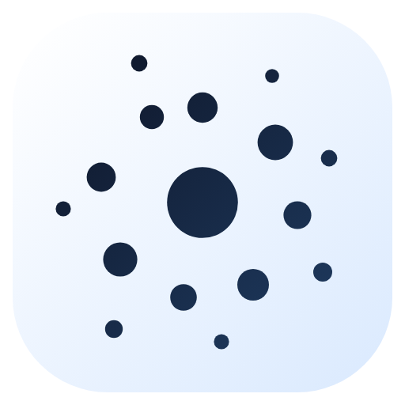</p>

A universal Mem0 long-term memory plugin for DeepSeek Harness (DSH).

Repository: <https://github.com/light-cheng/DSH-Mem0>

Three backends are supported:

- **Mem0 Platform**: the managed Mem0 API; only an API key is required, and it is the best fit for most users.
- **Self-hosted server**: connect to your own Mem0 REST service.
- **OSS Python sidecar**: reuse a local Mem0 Python SDK / Qdrant / embedding setup, suitable for local bge-m3, Qdrant and similar self-hosted environments.

## Features

- **Automatic recall**: on every turn, the latest real user message is used to search for related memories, injected into the model context as a `<mem0-relevant-memories>` data block. A failed or timed-out search never blocks the model request.
- **Automatic capture and filtering**: after a turn completes normally, the turn's user messages and the final assistant reply (not the intermediate narration between tool calls) are handed to Mem0 for fact extraction and storage, so long tool-heavy turns are still captured; interrupted, failed or rejected turns are not saved. The default heuristic filter skips greetings, short acknowledgements and command-only turns to reduce low-value memories.
- **Editable memory summary**: a structured summary is derived from stored memories, ranked by pinned/importance metadata and then freshness (newer facts first, decaying over roughly 90 days; text length only breaks ties), and injected before relevant memories. It has its own token budget, can be edited directly in the settings page, and can be read or rewritten by the agent through `mem0_profile_get` / `mem0_profile_update` / `mem0_profile_reset`. Manual edits survive weekly hygiene; **Rebuild from memories** restores the generated version.
- **Memory budgets and weekly hygiene**: recall memories and the profile each have a token budget; a memory hygiene pass runs every 7 days by default to deduplicate and prune the oldest over-budget memories. It only ever deletes memories written by this plugin (`metadata.source: "dsh"`), and automatic passes only preview until you confirm a manual run in the settings page.
- **Explicit tools**: `mem0_search`, `mem0_add`, `mem0_get`, `mem0_update`, `mem0_delete`, `mem0_status`, plus `mem0_profile_get`, `mem0_profile_update`, `mem0_profile_reset` for the memory summary.
- **Switchable backends**: Platform, self-hosted server and local OSS sidecar share the same tools and automatic memory logic.
- **Verifiable memory activity**: the settings page shows the last automatic capture / recall status and the most recently written memories (text, ID, time); it can open a **Memory library** to search every memory stored for the current user. **Last recalled memories** shows the texts that the most recent recall actually matched.
- **Foreground status icon**: below the chat composer there is a hollow globe made of dots of different sizes. It rolls along a tilted direction while automatic capture/recall is active, turns light blue and keeps rolling on success, and turns red on failure. The silhouette stays circular while rolling and never squashes. It uses dark dots in light themes and light dots in dark themes.
- **Bilingual UI and memory text**: labels follow DSH's language setting. With `translateMemories` on (off by default), stored memory text is translated into the page language with the current DSH model, cached, and falls back to the original text when no model is available.
- **Security boundaries**: the sidecar listens only on a random `127.0.0.1` port with a random token; common secrets are redacted before capture/recall; `mem0_status` never returns the API key.

## UI

After installation, open **Plugins** in the DSH sidebar and open **Mem0 Memory** under **Installed plugins**. You can choose a backend, inspect live connection status and save settings directly in the bundle detail page:

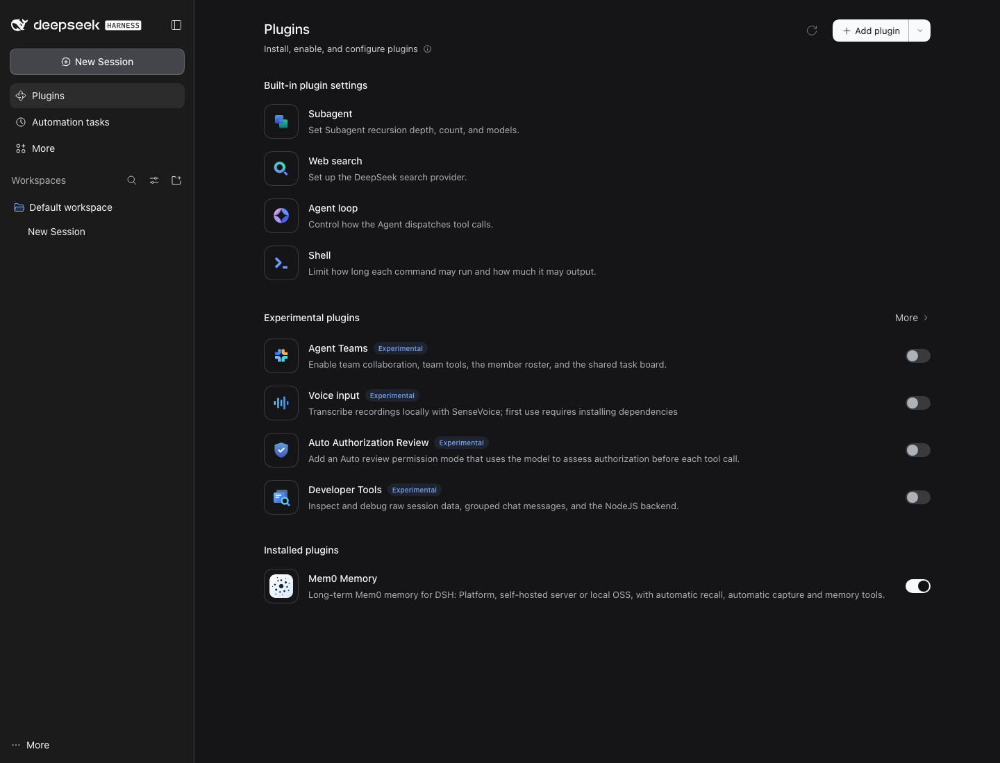

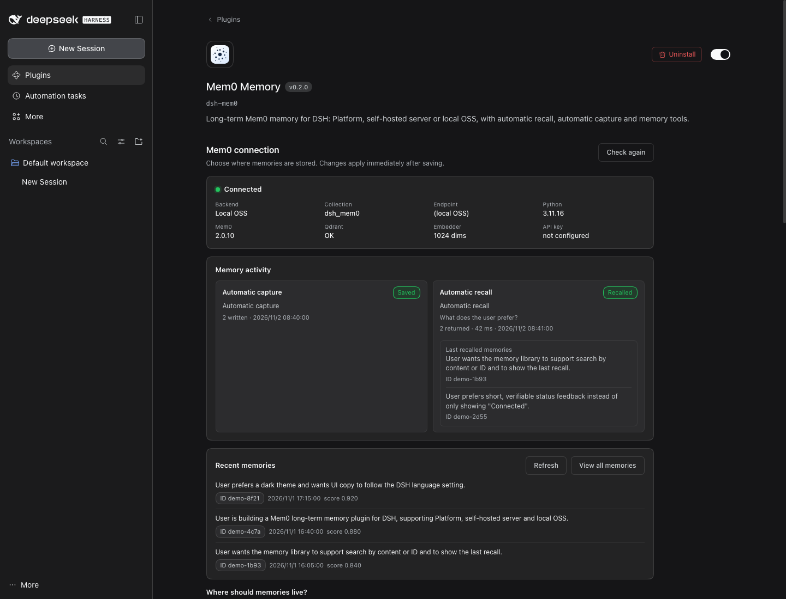

Each backend has its own fields and guidance:

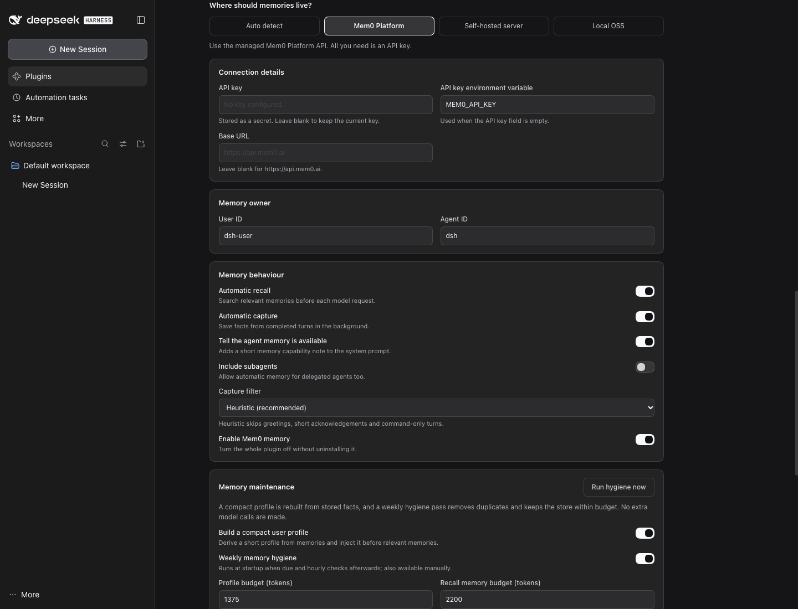

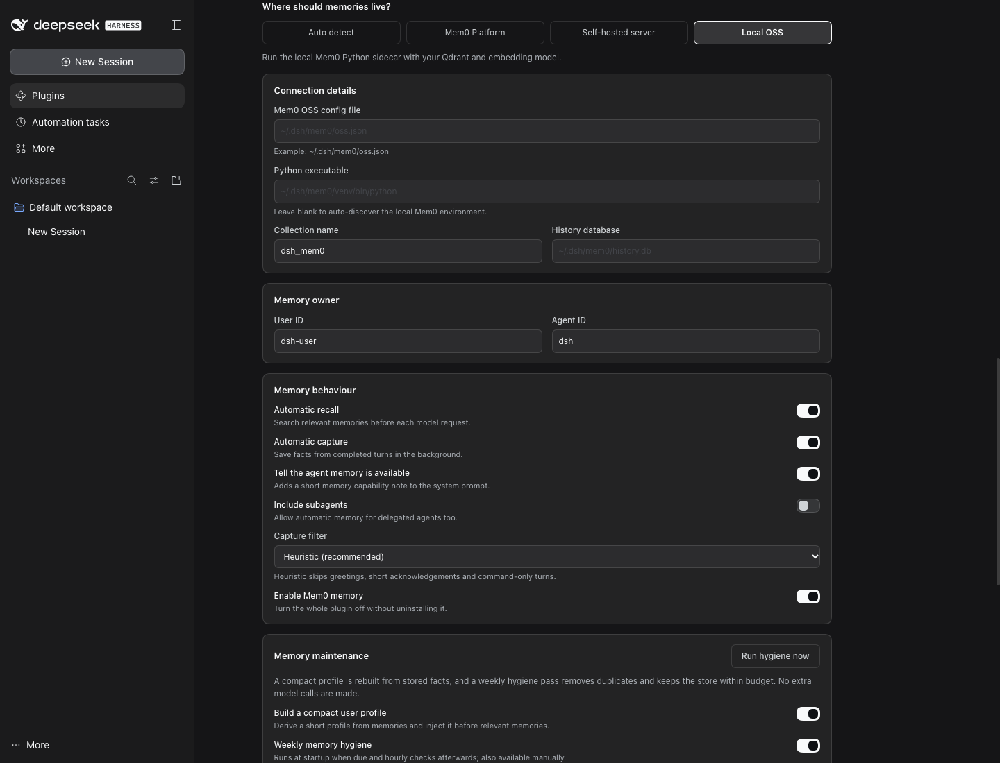

The **Test connection** button calls the same read-only health check as `mem0_status`, showing the current backend, collection, Python/Mem0/Qdrant/Embedder status, and never the API key.

**Memory summary** is the editable summary injected before relevant memories. It is shown as structured sections; use **Edit summary** to edit it and **Rebuild from memories** to regenerate it from the store. Manual edits survive weekly hygiene.

**Memory activity** records the latest automatic capture and recall results; **Recent memories** reads the backend directly and shows real memory text, ID and time. This makes it clear whether automatic capture actually worked.

**View all memories** opens the **Memory library**, where every memory stored for the current user can be searched by content or ID. **Last recalled memories** shows the texts, IDs, count and latency of the most recent automatic recall:

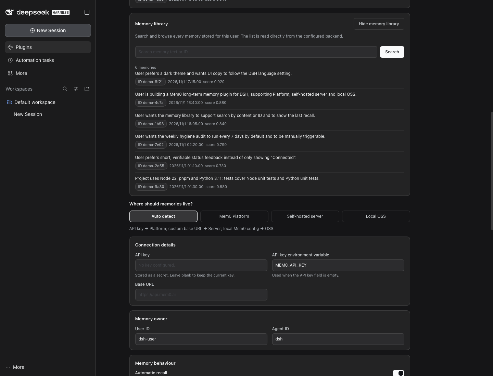

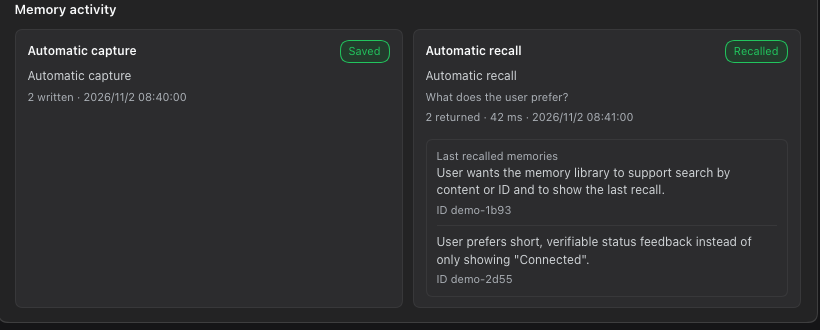

The **Memory summary** card shows the editable, structured summary that is injected before relevant memories. Save a manual version or rebuild it from the store:

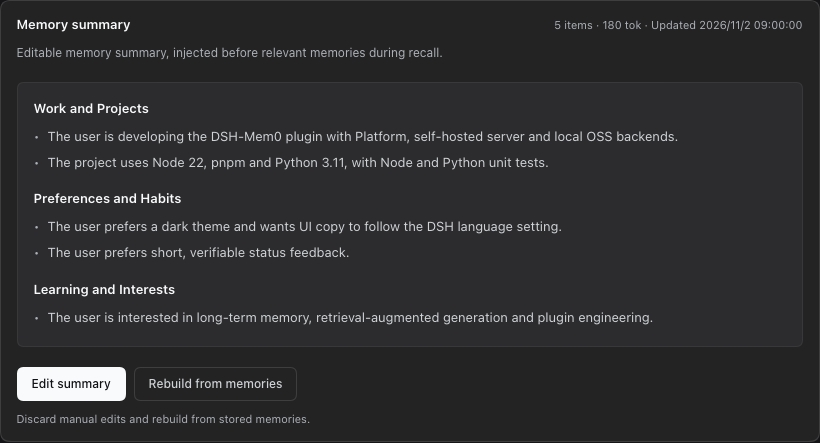

The **Memory maintenance** section lets you adjust the memory summary budget, recall budget, storage limits and hygiene interval, and shows the last/next hygiene time, the latest hygiene report (scanned, duplicates, pruned, deleted, failed, run time and trigger) and current memory size. **Run hygiene now** first computes a preview and asks you to confirm "delete N memories" before removing duplicates and over-budget memories written by this plugin; a manually edited memory summary is preserved.

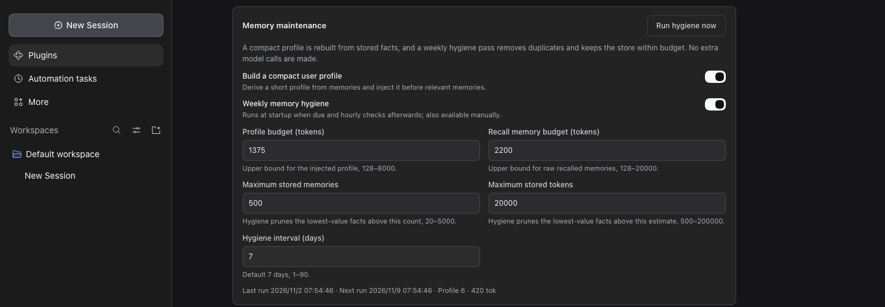

The dot-matrix globe below the chat composer stays still while idle, rolls along a tilted direction while recording, and turns light blue and keeps rolling on success. The rolling animation uses a 3D projection, so the dot sphere keeps a circular silhouette and does not squash or deform; it stays still when the system requests reduced motion.

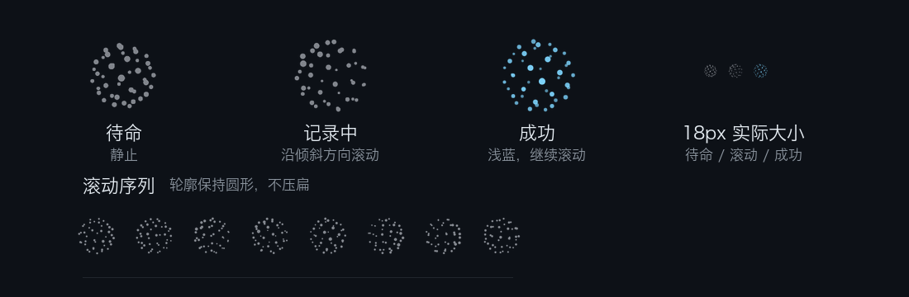

The actual status bar at the bottom of a conversation (cropped):


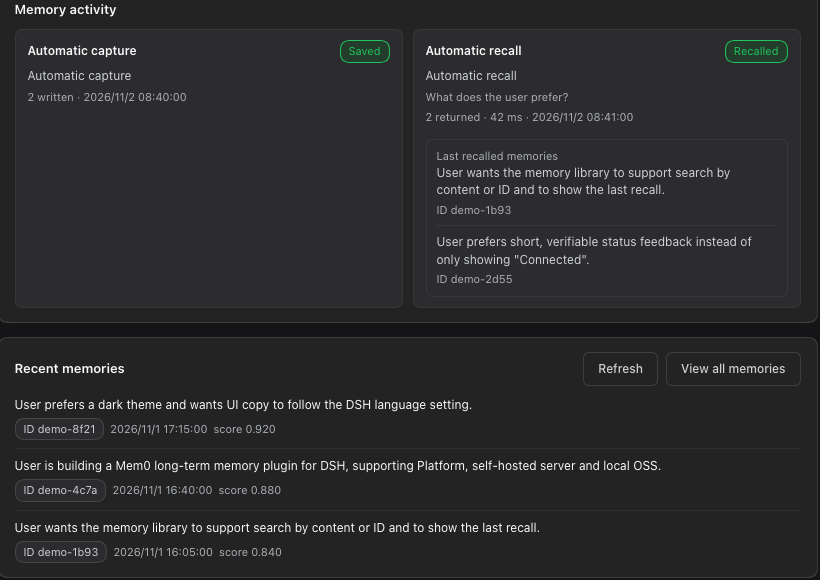

When **Test connection** succeeds, the status card shows a green **Connected** chip:

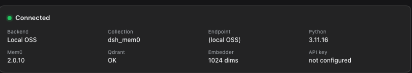

The UI follows DSH's language setting. When `translateMemories` is on (off by default, see [Privacy and data](#privacy-and-data)), the visible memory text, memory summary and recall preview are translated into the page language with the current DSH model; otherwise, or when translation is unavailable, the original text is shown. A Chinese screenshot is available in the [Chinese README](README.zh-CN.md).

## Memory maintenance

The **Memory maintenance** section separates several budgets that are easy to confuse:

- **Memory summary budget**: upper bound for the `<mem0-user-profile>` block, 1375 tokens by default.
- **Recall memory budget**: upper bound for the `<mem0-relevant-memories>` block, 2200 tokens by default.
- **Storage limits**: maximum number of memories (default 500) and estimated tokens (default 20000) retained after hygiene.

Hygiene runs every 7 days by default and can be set to 1–90 days. It runs once at plugin startup if due, then checks hourly. It deletes only duplicates and the oldest over-budget memories, and only among memories this plugin wrote (`metadata.source: "dsh"`, set by auto-capture and `mem0_add`). Memories written by other apps under the same `userId` are read into the summary but never deleted and do not count toward the storage limits. Until you have confirmed one manual **Run hygiene now**, automatic passes are dry runs: they write a report marked "Preview, nothing deleted" listing what would be deleted, and delete nothing. Each pass deletes at most 100 memories. The profile and hygiene history are stored in the current DSH profile's `dsh-mem0/maintenance.json`, not written back to Mem0. The latest report stays visible in the Memory maintenance card, including the scanned, duplicate, pruned, deleted and failed counts, run time and trigger; a manual **Run hygiene now** also returns the same counts.

The generated memory summary uses local deterministic logic without extra model calls. Facts are grouped into sections by topic. You can edit it at any time; manual edits are stored in `maintenance.json` and are not overwritten by hygiene. Use **Rebuild from memories** to return to the generated version. Section headings follow the dominant language of the memories (Chinese when most facts are Chinese, English otherwise).

To keep DeepSeek's prefix cache warm, the summary is a system-prompt section (`plugin:dsh-mem0:profile`) that changes only when the stored summary changes. The per-turn `<mem0-relevant-memories>` block is a runtime context (`mem0:recall`), which DSH appends next to the latest user message, so it never rewrites earlier history.

## Architecture

```text
DSH Agent
  ├─ system-prompt/assemble ──┐
  ├─ session/event            ├─> Node plugin (index.js + lib/)
  ├─ mem0_* tools            ─┘        │
  │                                     ▼
  │                          backend adapter (one of)
  │                          ├─ Mem0RestClient (platform / server)
  │                          └─ Mem0SidecarClient (oss)
  │                                     │
  │                                     ▼
  │                          Mem0 Platform / self-hosted server / local Python Mem0
```

## Installation

Install this directory through the DSH Plugin Manager (development/local install):

```text
plugin_manager action: install_bundle
target: <absolute path to this directory>
```

Or use the DSH CLI:

```bash
dsh plugin --profile desktop add link:"$(pwd)"
```

After the package is published to npm, install it by package name:

```bash
dsh plugin --profile desktop add dsh-mem0
```

If DSH reports `restart-required`, restart DSH before verifying.

> A local `link:` install makes DSH show the absolute checkout path under **Code source** in the plugin detail page. That is install metadata from the local profile, not part of the package. `npm pack` and registry installs contain no local paths; installing `dsh-mem0` from npm shows the package source instead. The published screenshots are captured so that this local-only row is not included.

## Configuration

After installation, configure it visually in **Plugins → Mem0 Memory** in the DSH sidebar (recommended); you can also write the profile's `cordis.patch.yml`. Full YAML example:

```yaml
- id: dsh-mem0
  name: dsh-mem0
  config:
    backend: platform
    apiKey: "your-platform-api-key"
    userId: "your-user-id"
    agentId: "dsh"
```

### Backend modes

#### Platform (simplest, recommended for new users)

```yaml
config:
  backend: platform
  apiKey: "your-platform-api-key"
  userId: "your-user-id"
```

The API key can also come from an environment variable instead of the config:

```yaml
config:
  backend: platform
  apiKeyEnv: MEM0_API_KEY
```

> **Note on `backend: auto`:** if `MEM0_API_KEY` (or the variable named by `apiKeyEnv`) is set in DSH's environment, `auto` picks the cloud Platform even when a local OSS config exists. `mem0_status` and the settings page show why the backend was chosen ("backend choice"). Set `backend` explicitly if you want a specific one.

#### Self-hosted Mem0 server

```yaml
config:
  backend: server
  baseUrl: "http://127.0.0.1:8888"
  authType: apiKey
  apiKey: "your-server-key"
  userId: "your-user-id"
```

`authType` supports `apiKey` (`X-API-Key`), `bearer`, `token` and `none` (for local services with `AUTH_DISABLED=true`).

#### OSS Python sidecar (local Qdrant / bge-m3)

First prepare a Mem0 OSS config file, for example `~/.dsh/mem0/oss.json`; see [examples/oss-config.example.json](examples/oss-config.example.json).

```yaml
config:
  backend: oss
  pythonPath: "~/.dsh/mem0/venv/bin/python"
  mem0ConfigPath: "~/.dsh/mem0/oss.json"
  collectionName: "dsh_mem0"
  userId: "your-user-id"
```

The Python environment needs:

```bash
python3 -m venv ~/.dsh/mem0/venv
~/.dsh/mem0/venv/bin/pip install "mem0ai>=2.0.10,<3" qdrant-client openai
```

This version **does not silently install** Python or Qdrant when the plugin loads, and does not modify the system Python. The settings page shows connection errors; prefer Platform, or prepare the local environment manually with the commands above. A better future flow is a guided **environment check + explicit one-click venv creation** in the settings page, rather than automatic execution at plugin install time.

The sidecar reads `oss.llm`, `oss.embedder` and `oss.vector_store` from `mem0ConfigPath` and overrides the collection name with `collectionName`; other Mem0 clients can keep using their own collections.

### All options

| Field | Default | Description |
|---|---|---|
| `backend` | `auto` | `auto` / `platform` / `server` / `oss` |
| `apiKey` | empty | Platform or server API key |
| `apiKeyEnv` | `MEM0_API_KEY` | API key environment variable name |
| `baseUrl` | Platform: `https://api.mem0.ai`; server: `http://127.0.0.1:8888` | API endpoint |
| `authType` | `apiKey` (Platform is fixed to token) | `apiKey` / `bearer` / `token` / `none` |
| `pythonPath` | auto-discovered | OSS-mode Python interpreter |
| `mem0ConfigPath` | `~/.dsh/mem0/oss.json` | OSS-mode Mem0 config file |
| `collectionName` | `dsh_mem0` | OSS-mode Qdrant collection |
| `historyDbPath` | `~/.dsh/mem0/history.db` | OSS sidecar local history database |
| `userId` | `dsh-user` | Memory owner |
| `agentId` | `dsh` | Agent identifier attached on DSH writes; recall currently filters by `userId`, not `agentId` |
| `autoRecall` | `true` | Automatic recall |
| `autoCapture` | `true` | Automatically save completed turns |
| `announceToAgent` | `true` | Announce memory capability to the model |
| `includeSubagents` | `false` | Enable automatic memory for subagents |
| `captureMaxChars` | `450` | Per-message truncation limit for automatic capture |
| `captureFilter` | `heuristic` | `heuristic` skips low-value turns; `off` saves every completed turn |
| `recallTopK` | `5` | Number of automatic recall results |
| `memoryBudgetTokens` | `2200` | Token budget for injected recalled memories |
| `profileEnabled` | `true` | Generate and inject a compact user profile |
| `profileBudgetTokens` | `1375` | Token budget for the injected profile |
| `storeMaxMemories` | `500` | Maximum memories retained after hygiene |
| `storeMaxTokens` | `20000` | Estimated token limit for retained memories after hygiene |
| `hygieneEnabled` | `true` | Enable memory hygiene |
| `hygieneIntervalDays` | `7` | Hygiene interval in days, 1–90 |
| `translateMemories` | `false` | Translate memory text on the settings page with the DSH default model (sends memory text to that model) |
| `timeoutMs` | `30000` | Per-request timeout for REST backends |
| `enabled` | `true` | Master switch |

Reload the plugin or restart DSH after changing configuration.

## Tools

| Tool | Purpose |
|---|---|
| `mem0_search` | Semantic search; returns `[mem0:<id>]` and relevance |
| `mem0_add` | Store one persistent fact verbatim (`infer:false`) |
| `mem0_get` | Read by ID, or list for the configured user |
| `mem0_update` | Update text by ID; ownership is checked |
| `mem0_delete` | Delete one memory by ID; no bulk delete/reset |
| `mem0_status` | Check backend connection and storage status |
| `mem0_profile_get` | Read the editable memory summary |
| `mem0_profile_update` | Replace memory summary text; empty clears it |
| `mem0_profile_reset` | Rebuild memory summary from stored facts |

## Tests

```bash
pnpm install --ignore-scripts
node --check index.js
node --test

# OSS-mode Python tests (using your Mem0 Python environment)
PYTHONPYCACHEPREFIX="$PWD/.pycache" \
  python3 -m unittest discover -s python/tests -v

# Real local OSS smoke test (creates and deletes a temporary Qdrant collection)
node scripts/smoke-sidecar.mjs
```

## Privacy and data

**What leaves this machine**

| Backend / feature | Sent | To |
|---|---|---|
| Platform | Captured conversation text (user and assistant messages, redacted and truncated), recall queries, `userId`/`agentId`, metadata `source`, `channel`, `session_id` | `https://api.mem0.ai` (or your `baseUrl`) |
| Server | The same | Your self-hosted Mem0 server |
| OSS | The same, via a loopback-only sidecar | The LLM, embedder and vector store in your `oss.json`; if those are cloud APIs (e.g. OpenAI), the text goes there |
| Memory translation (`translateMemories`, off by default) | Memory text shown on the settings page, up to the full list when the memory browser opens | DSH's current default model, which may be a cloud model |

The working directory is not sent. With `backend: auto`, an inherited `MEM0_API_KEY` alone selects the Platform; check "backend choice" in `mem0_status` or the settings page.

**What is stored locally**

- `<DSH profile>/dsh-mem0/maintenance.json` (mode 0600): the memory summary text and hygiene reports. Reports keep only memory ids, counts and reasons, not the text of deleted memories.
- `<DSH profile>/dsh-mem0/translation-cache.json` (mode 0600, only when translation is on): memory text and its translation in plain form. Entries are dropped when a memory is deleted through `mem0_delete` or hygiene; memories deleted elsewhere stay until the cache evicts them (2,000 entries max). Delete the file to clear it.
- OSS mode: `historyDbPath` (`~/.dsh/mem0/history.db`) and the Qdrant data of your OSS setup.

**Other notes**

- In Platform/server mode, memories are stored by the corresponding service; read that service's privacy and retention policy.
- In OSS mode, memories are stored in the Qdrant/embedder/LLM services you configure.
- `autoCapture` is enabled by default; set it to `false` if you do not want automatic saving. The default `captureFilter: heuristic` only skips clearly low-value turns; common secrets (API keys such as `sk-`, `tvly-`, `AIza…`, JWTs, `Bearer` tokens, passwords in URLs, `password=` / `密码：` phrasing, private keys) are still redacted before writing, but regular expressions are not a substitute for full secret management.
- Weekly hygiene deletes duplicates and over-budget memories written by this plugin, and only after you have confirmed one manual run. Deletion is real and there is no recycle bin; if you want full manual control, set `hygieneEnabled: false`. The profile is still built when missing, but memories are not automatically deleted.
- The sidecar listens only on loopback, with a random port and random token; `mem0_status` never returns the API key.

## Marketplace notes

- Package name: `dsh-mem0`, `private: false`, with `dsh.bundle` and `dsh-plugin` keywords.
- Marketplace inclusion requires a public GitHub repository, the `dsh-plugin` topic, a repository at least 1 day old, and a `data/plugins/<owner>__<repo>.yml` entry in `awesome-dsh-plugin` with category `memory`.
- The repository is linked through `repository` / `homepage`: `https://github.com/light-cheng/DSH-Mem0`. It includes `screenshots.json` with eight marketplace screenshots, plus localized sets under `assets/screenshots/` (Chinese) and `assets/screenshots/en/` (English). The market reads `screenshots.json` from this repository; only the plugin YAML is submitted to awesome-dsh-plugin.
- The plugin ships a visual settings page (`dsh.client` + `plugins.bundle.config`). A GUI is not required for listing, but this plugin provides one so users can configure all three backends and test the connection right after installation.
- OSS mode depends on external Python/Qdrant/embedding services; the README states this clearly and does not describe the plugin as "zero dependencies".

## Release notes

Release notes are bilingual with English first: [RELEASE.md](RELEASE.md).

## License

MIT.
