# DSH-Mem0

[English](README.md) | **简体中文**

<p align="center"></p>

给 DeepSeek Harness（DSH）使用的通用 Mem0 长期记忆插件。

仓库：<https://github.com/light-cheng/DSH-Mem0>

支持三种后端：

- **Mem0 Platform**：使用 Mem0 托管 API，只需 API Key，适合大多数用户。
- **Self-hosted server**：连接自建 Mem0 REST 服务。
- **本地（OSS）**：记忆存在本机的一个 SQLite 文件里（`~/.dsh/mem0/memory.sqlite`），使用你自己的 embedding 模型（oMLX / LM Studio / vLLM 等 OpenAI 兼容服务，或 Ollama）和抽取 LLM。它是 Mem0 2.2.1 写入与检索流程的 Node 原生移植：不需要 Python，不需要 Qdrant，除了这两个模型不需要别的服务。

## 能力

- **自动召回**：每个回合用最近一条真实用户消息搜索相关记忆，以 `<mem0-relevant-memories>` 数据块注入模型上下文；失败或超时不会阻塞模型请求。
- **自动保存与过滤**：回合正常完成后，把本轮的用户消息和助手的最终回复（不含工具调用之间的中间叙述）交给 Mem0 做事实抽取并写入，工具调用很多的长回合也会被保存；中断、失败、被拒绝的回合不会保存。默认的启发式过滤会跳过问候、简短确认和纯命令回合，减少无价值记忆。
- **可编辑的记忆摘要**：从已存记忆中按置顶/重要度元数据、再按新鲜度（越新越靠前，约 90 天衰减；文本长度只用于平局判定）提取一份结构化摘要，在相关记忆之前注入；它有独立 token 预算，可以直接在设置页编辑，也可以由 agent 通过 `mem0_profile_get` / `mem0_profile_update` / `mem0_profile_reset` 读取或改写。手动编辑不会被周巡检覆盖；「从记忆重建」可恢复自动生成版本。
- **记忆预算与周巡检**：召回记忆和画像各有 token 预算；默认每 7 天做一次记忆卫生巡检，去重并清理超预算中最旧的记忆。巡检只会删除本插件写入的记忆（`metadata.source: "dsh"`），并且在你于设置页确认一次手动巡检之前，自动巡检只出预览、不删除。
- **显式工具**：`mem0_search`、`mem0_add`、`mem0_get`、`mem0_update`、`mem0_delete`、`mem0_status`，以及记忆摘要的 `mem0_profile_get`、`mem0_profile_update`、`mem0_profile_reset`。
- **后端可切换**：Platform、自托管 server、本地 SQLite 后端共用同一套工具与自动记忆逻辑。
- **可验证的记忆活动**：设置页显示自动保存 / 自动召回的最后状态，列出最近写入的记忆（文本、ID、时间），并可打开「记忆库」搜索当前用户的全部记忆；「上次召回的记忆」显示最近一次召回实际命中的文本。
- **前台状态图标**：对话输入框下方有一个由大小不一的圆点组成的镂空地球仪；自动保存/召回时沿倾斜方向滚动，成功后变成浅蓝色并继续滚动，失败显示红色。滚动时球体轮廓保持圆形，不会压扁。浅色主题下是黑点，深色主题自动用浅色点保证可见。
- **中英双语界面与记忆内容**：文案跟随 DSH 的语言设置；开启 `translateMemories`（默认关闭）后，已存记忆文本会用当前 DSH 模型翻译成页面语言，带缓存，没有可用模型时回退原文。
- **安全边界**：本地后端不开端口、不起额外进程；写入/召回前做常见密钥脱敏；`mem0_status` 不输出 API key。

## 界面

安装后打开 DSH 侧栏的「插件」页，在「已安装插件」中打开「Mem0 长期记忆」，即可直接在 Bundle 详情里选择后端、查看实时连接状态并保存设置：

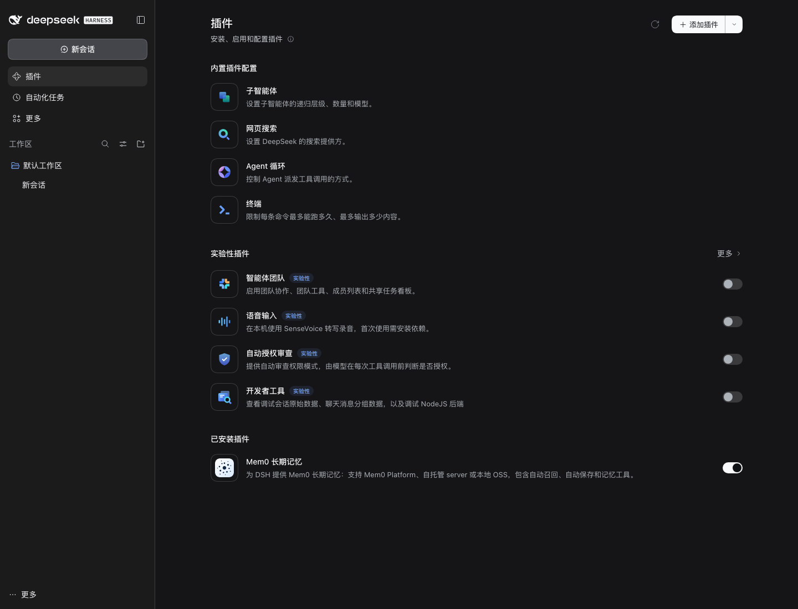

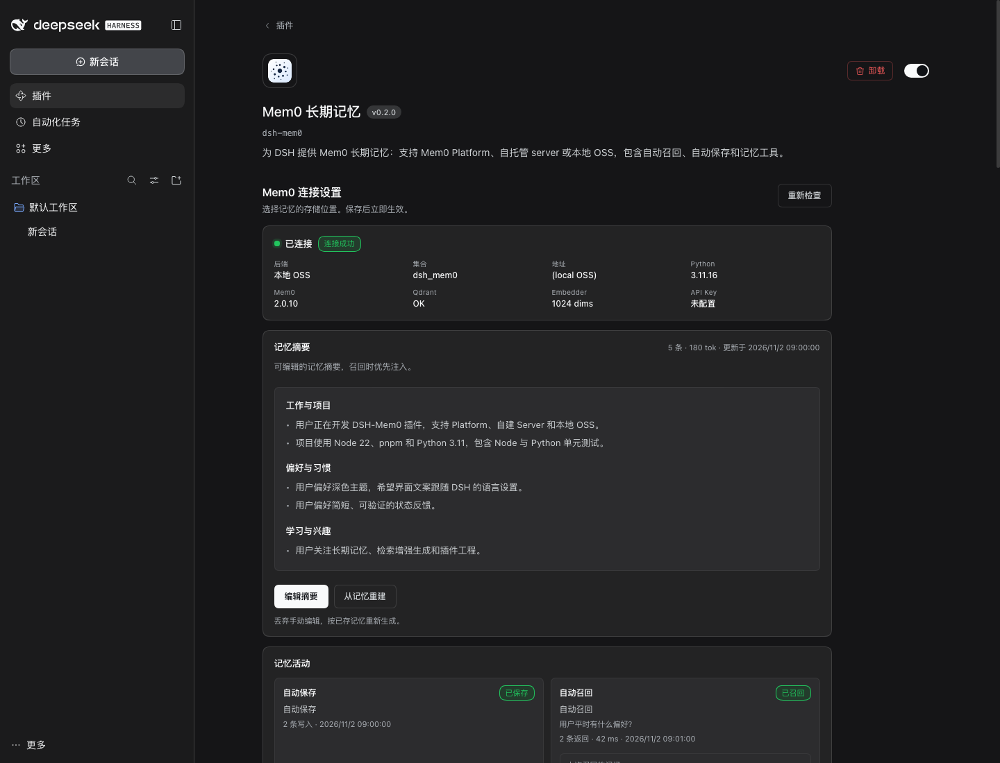

支持三种后端，每种都有对应的字段和引导：

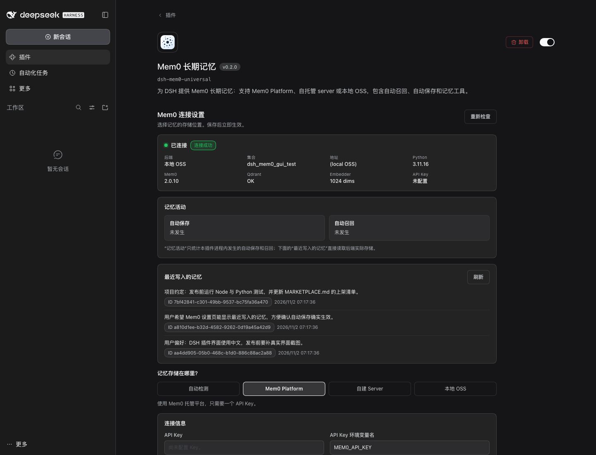

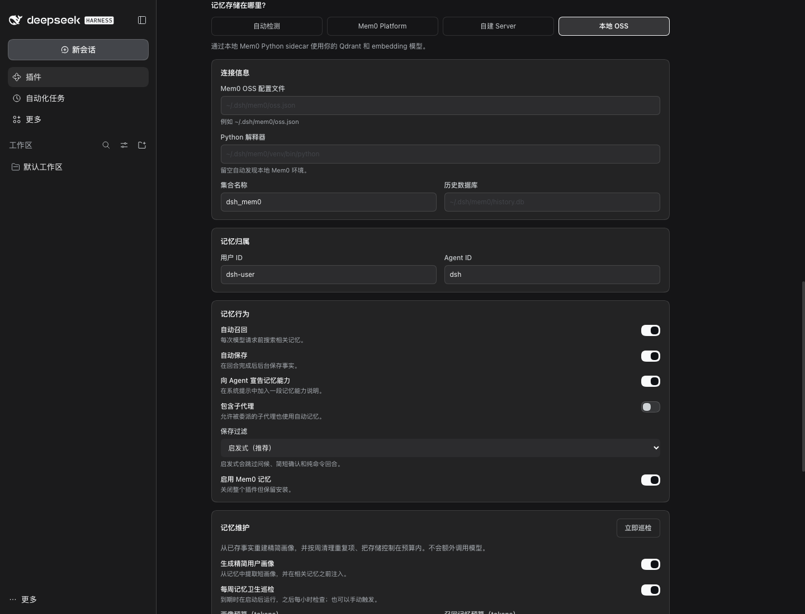

页面里的「测试连接」会调用 `mem0_status` 同源的只读健康检查，显示当前后端、记忆存在哪里、存储 / embedding / 抽取 LLM 的状态，不会显示 API Key。

「记忆摘要」是召回时优先注入的可编辑摘要，按主题分节显示；点「编辑摘要」修改并保存，下一轮对话即可使用；「从记忆重建」会丢弃手动编辑，按已存记忆重新生成。

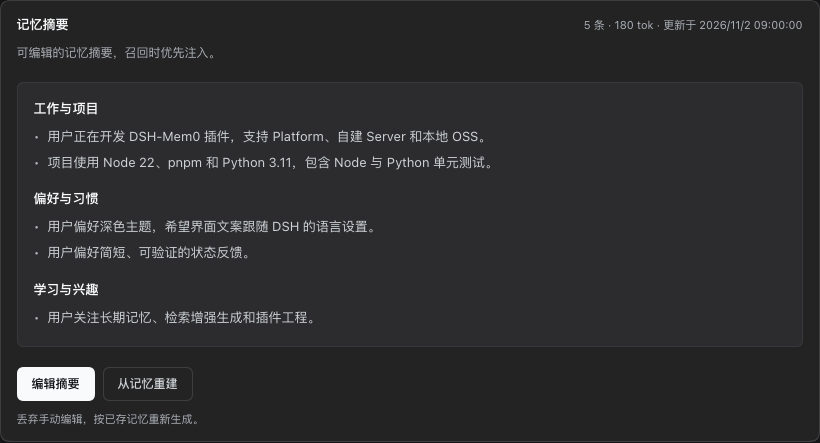

「记忆活动」会记录最近一次自动保存和自动召回的结果；「最近写入的记忆」直接读取后端，显示真实记忆文本、ID 和时间。这样不需要猜自动保存有没有生效。自动保存执行了但没有写入任何记忆（新增、更新、删除都是 0）时，徽章是灰色的「无新内容」而不是绿色的「已保存」，状态栏显示「无新内容可记」；Platform、server 后端的回应里没有计数时，仍显示「已保存」：

「查看全部记忆」会打开「记忆库」，可按记忆内容或 ID 搜索当前用户存储的全部记忆。本插件写入的记忆（`metadata.source = "dsh"`）有「删除」按钮：先显示这条记忆的完整内容和 ID 并要求确认，确认后才删除这一条，同时清掉它的译文缓存并刷新列表。其他应用写入的记忆、属于其他 Mem0 用户的记忆不显示按钮，插件的路由（`DELETE /dsh-mem0/gui/memories?id=…`）也会以 HTTP 403 拒绝并说明原因。不提供批量删除、清空全部或按条件删除。「上次召回的记忆」显示最近一次自动召回实际命中的文本、ID、条数和延迟：

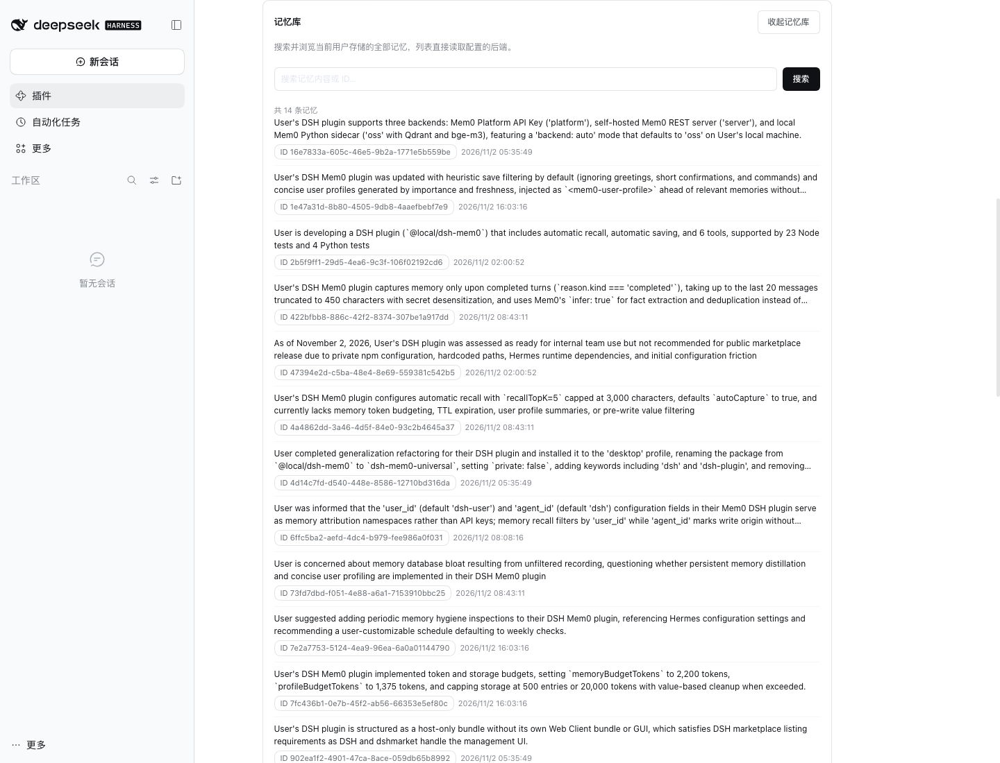

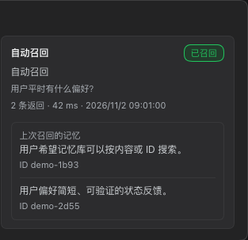

「记忆维护」区域可以调整记忆摘要预算、召回预算、存储上限和巡检间隔，并查看上次/下次巡检时间、最近一次巡检报告（扫描、重复、预算清理、删除、失败数量，以及运行时间和触发方式）和当前记忆摘要规模；「立即巡检」会先生成预览并提示「将删除 N 条」，确认后才清理本插件写入的重复项与超预算记忆，不会覆盖手动编辑的记忆摘要：

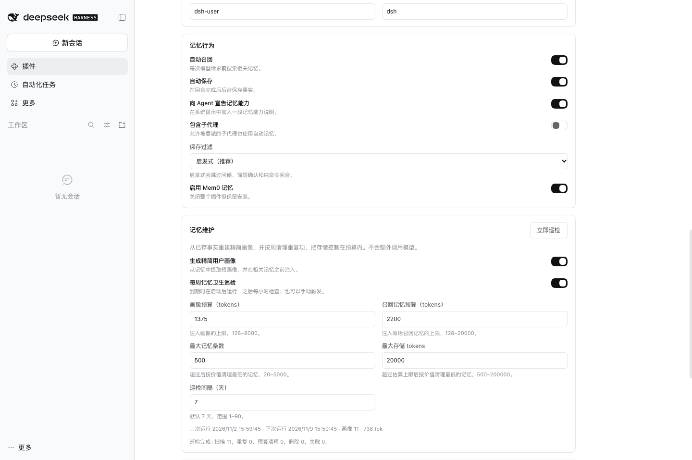

对话输入框下方还会显示点阵地球仪：待命时静止，记录中沿倾斜方向滚动，成功后变成浅蓝色并继续滚动。滚动使用三维投影，点阵球体的轮廓保持圆形，不会压扁或变形；系统开启「减少动态效果」时保持静止。

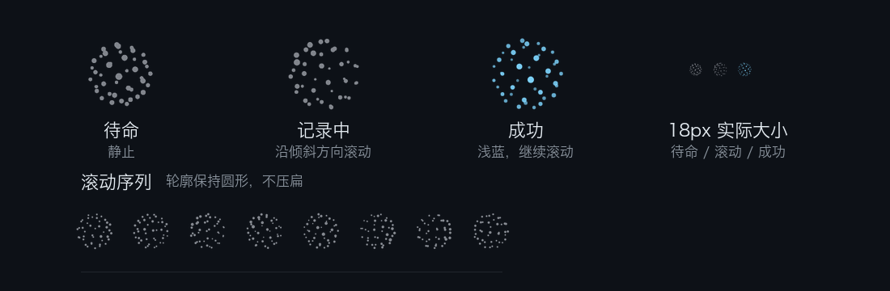

实际会话底部的状态条（截取）：


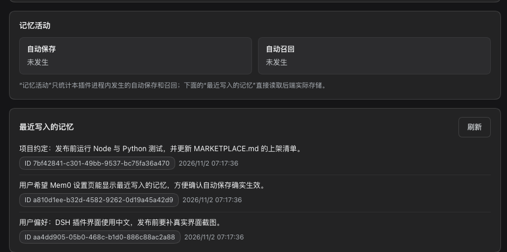

「测试连接」成功时，状态卡会显示绿色的「连接成功」：

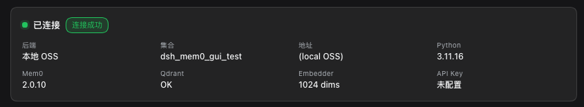

英文界面（跟随 DSH 语言设置）：

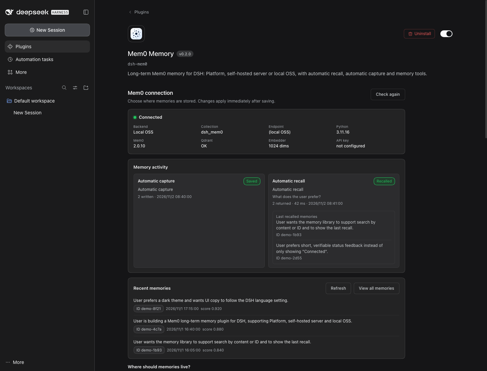

## 记忆维护

设置页的「记忆维护」区域把几个容易混淆的预算分开：

- **记忆摘要预算**：`<mem0-user-profile>` 数据块的上限，默认 1375 tokens。
- **召回记忆预算**：`<mem0-relevant-memories>` 数据块的上限，默认 2200 tokens。
- **存储上限**：巡检后保留的最大记忆条数（默认 500）和估算 tokens（默认 20000）。

巡检默认每 7 天一次，可改成 1–90 天；插件启动时若已到期会跑一次，之后每小时检查一次。巡检只删除重复项和超预算中最旧的记忆，并且只在本插件写入的记忆（自动保存和 `mem0_add` 会写入 `metadata.source: "dsh"`）里挑选；同一 `userId` 下其他应用写入的记忆会参与摘要，但绝不删除，也不计入存储上限。在你确认过一次手动「立即巡检」之前，自动巡检都是预览：报告标明「预览，未删除」并列出将删除的记忆，不做任何删除。每次巡检最多删除 100 条。不会清空整个库；画像和巡检历史保存在当前 DSH profile 的 `dsh-mem0/maintenance.json`，不写回 Mem0。最近一次报告会持续显示在「记忆维护」卡片中，包括扫描、重复、预算清理、删除和失败数量、运行时间与触发方式；手动「立即巡检」也会返回同一组数量。

**巡检删除什么，手动巡检如何确认。**

- *重复只指完全相同的内容*：完整文本做 Unicode NFC、大小写统一和空白合并后比哈希。标点、数字和长文本的结尾都算数，所以 `dose 1.5 mg` 和 `dose 15 mg` 是两条不同的事实。只是看起来像的（去掉标点后相同、或前 240 字相同）在报告里列为「疑似重复」，绝不删除。
- *手动巡检 = 预览 + 确认*。「立即巡检」先预览，得到带 `planId` 的计划（15 分钟内、本插件实例内有效）。确认时带上这个 `planId` 和一个幂等键，并且不会自动重试。确认只删除计划里仍然存在、仍是本插件写入、且预览后没有改过的记忆。同一个计划只执行一次，重复提交拿回第一次的结果。插件重载或计划过期后，需要重新预览。
- *报告按实际结果计算*：剩余数量和摘要都是「扫描到的集合减去删除成功的记忆」。预览里的数量是预计剩余。
- *一切按记忆库分开*。记忆库 = 后端 + 端点（不含凭据；OSS 用 `mem0ConfigPath`）+ OSS collection + `userId` + `agentId`。摘要、巡检历史和自动删除授权都按记忆库分开存在 `maintenance.json` 里。换了其中任何一项，旧摘要不再注入，自动巡检重新只做预览，直到你为新记忆库确认一次巡检。同一端点、同一用户但换了另一个账户的 API Key，这种情况分辨不出来。从旧版 `maintenance.json` 升级时，只保留同一用户的手动摘要；自动巡检重新只做预览，直到下一次确认巡检。
- *停止*：停用或重载插件会中止正在进行的列表和删除请求；正在跑的巡检在下一次删除前停下，不再写任何状态。重载后的新实例会等旧巡检停下再开始。

**删除或修改记忆与摘要**。删除或更新一条记忆（`mem0_delete` / `mem0_update` 工具，或记忆库里的「删除」）后，用到它的自动摘要立即停止注入，并在后台重建；关闭巡检时也一样。手动摘要是你写的内容，会继续注入；如果它是从用到这条记忆的自动摘要改出来的（或来源未知），「记忆摘要」卡片会提示摘要可能含已删除或过时的内容，直到你编辑或重建。摘要和自动保存一样脱敏：保存前一次、注入前再一次，并去掉插件自己的数据块标记。自动召回和 `mem0_search` 的查询在发给后端和显示在活动记录之前也会脱敏。

自动生成的记忆摘要由本地确定性逻辑生成，不额外调用模型；你可以随时手动编辑，内容保存在 `maintenance.json`，不会被巡检覆盖。点「从记忆重建」可恢复自动生成版本。分节标题跟随记忆的主要语言：多数记忆是中文时用中文，否则用英文。

为了让 DeepSeek 的前缀缓存持续命中，记忆摘要作为系统提示词分段（`plugin:dsh-mem0:profile`）注入，只在已保存的摘要变化时才变；每轮变化的 `<mem0-relevant-memories>` 召回块作为运行时上下文（`mem0:recall`），由 DSH 追加在最新一条用户消息旁边，不会改写之前的历史。

## 与上下文插件配合

上下文管理插件（例如 dsh-strata）可以通过下面的名字和标记识别 DSH-Mem0 注入的内容。这些名字和标记跨版本保持不变；改动任何一个都算不兼容变更，由 `test/interop-contract.test.js` 把关。

| 内容 | 放在哪里 | 名字 | 文本开头 / 结尾 | 变化频率 |
|---|---|---|---|---|
| 记忆摘要 | 系统提示段 | `plugin:dsh-mem0:profile` | `<mem0-user-profile>` … `</mem0-user-profile>` | 只在已存摘要变化时 |
| 召回的记忆 | 运行时上下文，总在最后 | `mem0:recall` | `<mem0-relevant-memories>` … `</mem0-relevant-memories>` | 通常每轮都变 |

- DSH 把所有运行时上下文拼成一个快照；只要拼接后的文本有变化，就把它作为 user 角色消息（`source.kind: "runtime-context"`）追加到历史。旧快照会留在历史里，其中的召回块已经过时：上下文插件可以直接裁掉或丢弃它们，不需要模型摘要，也不需要保留原文，因为 Mem0 随时可以重新召回。最新的那个快照不要动。
- 这个快照不是用户输入。自动保存只读取来源为 `user` 的 `user/message` 事件，所以召回块不会被再写回 Mem0。
- 自动保存在 `turn/end` 时进行，用的是 DSH-Mem0 从本轮事件里缓存的文本（用户消息和助手的最终回复），不读会话历史，也不读工具输出。所以无论在保存之前还是之后，回合结束时裁剪历史都不会改变保存的内容。
- 召回块里的记忆文本会去掉伪造的块标记，每个块只有一对开头和结尾标记。

### dsh-strata

同时安装 [dsh-strata](https://www.npmjs.com/package/@lightcheng/dsh-strata) 时，两个插件按一份共同约定配合：

- **共用召回预算。** 每次召回前，DSH-Mem0 向 Strata 的可选服务 `strataBudget` 询问本轮召回块最多能用多少 token：平时是完整的 `memoryBudgetTokens`；上下文超过 65%（`tight`）时减半；超过 75%（`critical`）时最多 512。额度为 0 时本轮不召回。召回块用 Strata 的 token 计数（和它的阈值同一套）来裁剪。没装 Strata，或者服务出错、返回不可用的值时，召回照旧使用 `memoryBudgetTokens`。记忆摘要不按轮缩减：它在有缓存的系统提示里，每轮改动的代价比省下的 token 更大。`mem0_status` 和「最近活动」卡片会显示上一次的预算，例如 `recall budget 1100 / 2200 (strata: tight)`。
- **折叠摘要作为记忆来源（`captureStrataFolds`，默认关闭）。** 打开它并且开启自动保存时，Strata 每落地一份一级折叠摘要（`strata/fold-landed`，只处理 tier 1，只处理主代理会话），就脱敏后经同一个保存队列写入 Mem0，metadata 为 `source: "dsh"`、`via: "dsh-strata"`、`fold`、`tier`、`session_id`，所以巡检会像对待其他自动保存一样处理它。这些回合已经被自动保存过一次，这里是同一段内容的第二份、更干净的摘要；重复的事实由 Mem0 自己的推理合并。空的或价值低的摘要会被跳过。召回块不会进入 Strata 的归档，Strata 会直接丢弃过时的召回快照，不会折叠它们。

## 架构

```text
DSH Agent
  ├─ system-prompt/assemble ──┐
  ├─ session/event            ├─> Node 插件（index.js + lib/）
  ├─ mem0_* tools            ─┘        │
  │                                     ▼
  │                          后端适配器（二选一）
  │                          ├─ Mem0RestClient（platform / server）
  │                          └─ Mem0NativeClient（oss）
  │                          （共用的 HTTP、超时和熔断：lib/http.js）
  │                                     │
  │                     ┌───────────────┴──────────────┐
  │                     ▼                              ▼
  │          Mem0 Platform / 自建 server      SQLite 存储（node:sqlite，WAL）
  │                                           + 你的 embedding + 你的 LLM
```

## 安装

通过 DSH Plugin Manager 安装本目录（开发/本地安装）：

```text
plugin_manager action: install_bundle
target: <本目录的绝对路径>
```

也可以用 DSH CLI：

```bash
dsh plugin --profile desktop add link:"$(pwd)"
```

发布到 npm 后可以按包名安装：

```bash
dsh plugin --profile desktop add dsh-mem0
```

安装后如果提示 `restart-required`，重启 DSH 后再验证。

> 本地 `link:` 安装时，DSH 插件详情页的「代码来源」会显示本机 checkout 路径。这是本地 profile 的安装元数据，不是插件包内容；`npm pack` 和从 npm 安装的包不包含本机路径，从 npm 安装会显示包来源。发布用的截图已避开这一行。

## 配置

安装后可以直接在 DSH 侧栏「插件」页的「Mem0 长期记忆」Bundle 详情中可视化配置（推荐）；也可以手写 profile 的 `cordis.patch.yml`。完整 YAML 示例：

```yaml
- id: dsh-mem0
  name: dsh-mem0
  config:
    backend: platform
    apiKey: "your-platform-api-key"
    userId: "your-user-id"
    agentId: "dsh"
```

### 后端模式

#### Platform（最简单，推荐新用户）

```yaml
config:
  backend: platform
  apiKey: "your-platform-api-key"
  userId: "your-user-id"
```

API Key 不必写进插件配置。推荐存到 DSH 凭据里（例如 `~/.dsh/.credentials.yaml`），这样它不会出现在 profile 配置中：

```yaml
version: 1
refs:
  MEM0_API_KEY: m0-your-key
```

然后按名字引用（这也是默认值）：

```yaml
config:
  backend: platform
  apiKeyEnv: MEM0_API_KEY
```

查找顺序：配置里的 `apiKey` → DSH 凭据里 `apiKeyEnv` 指定的名字（先查凭据文件，再查启动环境和 `.env` 文件）→ 同名环境变量。使用凭据时，更换 Key 后下一次请求就会生效，不用重启。`mem0_status` 会显示 Key 的来源（`key source: config`、`credentials`、`env` 或 `none`），不显示 Key 本身。

> **关于 `backend: auto`：** 只要 DSH 凭据或 DSH 的环境变量里有 `MEM0_API_KEY`（或 `apiKeyEnv` 指定的名字），`auto` 就会选择云端 Platform，即使本地有 OSS 配置。`mem0_status` 和设置页会显示「后端选择依据」。想用特定后端请明确设置 `backend`。

#### Self-hosted Mem0 server

```yaml
config:
  backend: server
  baseUrl: "http://127.0.0.1:8888"
  authType: apiKey
  apiKey: "your-server-key"
  userId: "your-user-id"
```

`authType` 支持 `apiKey`（`X-API-Key`）、`bearer`、`token` 和 `none`（`AUTH_DISABLED=true` 的本地服务）。

<a id="local-backend"></a>
#### 本地后端（SQLite，不需要 Python）

`backend: oss` 把记忆存在一个 SQLite 文件里，默认 `~/.dsh/mem0/memory.sqlite`（Windows：`%USERPROFILE%\.dsh\mem0\memory.sqlite`）。它用 DSH 自带 Node（24.9 及以上）内置的 `node:sqlite`，什么都不用装。你需要准备两个模型：

- **embedding 模型**：任意 OpenAI 兼容的 `/embeddings` 接口（oMLX、LM Studio、vLLM、OpenAI 等），或 Ollama（`/api/embed`）；
- **抽取 LLM**：任意 OpenAI 兼容的 `/chat/completions` 接口（DeepSeek、本地网关等）。

在 `~/.dsh/mem0/oss.json` 的 `dsh_mem0` 段里配置它们，DSH 的设置同步不会重写这个文件（见 [examples/oss-config.example.json](examples/oss-config.example.json)）：

```json
{
  "dsh_mem0": {
    "userId": "your-user-id",
    "embedderProvider": "openai",
    "embedderBaseUrl": "http://127.0.0.1:8000/v1",
    "embedderModel": "bge-m3",
    "embedderDims": 1024,
    "embedderApiKeyRef": "MEM0_EMBEDDER_API_KEY",
    "llmBaseUrl": "https://api.deepseek.com/v1",
    "llmModel": "deepseek-chat",
    "llmApiKeyRef": "MEM0_LLM_API_KEY"
  }
}
```

密钥按名字引用（`embedderApiKeyRef`、`llmApiKeyRef`），每次请求时先查 DSH 凭据（`~/.dsh/.credentials.yaml`），再查环境变量；密钥本身不写进 `oss.json` 或 profile。Mem0 自己格式的 `oss.json`（`oss.embedder` / `oss.llm`，带明文 `api_key`）仍可作为兜底使用；`oss.vector_store` 段会被忽略。同样的字段也可以写在 profile 配置里；profile 优先于 `dsh_mem0` 段，等于默认值的视为未设置。

| `dsh_mem0` 字段 | 默认值 | 含义 |
| --- | --- | --- |
| `storePath` | `~/.dsh/mem0/memory.sqlite` | SQLite 文件 |
| `embedderProvider` | `openai` | `openai`（任意 OpenAI 兼容服务）或 `ollama` |
| `embedderBaseUrl` | Ollama：`http://localhost:11434` | 例如 `http://127.0.0.1:8000/v1` |
| `embedderModel` | — | 例如 `bge-m3` |
| `embedderDims` | 取模型输出 | 设置后作为 `dimensions` 发送（仅 OpenAI 兼容） |
| `embedderApiKeyRef` | — | embedding 密钥的凭据名 |
| `llmBaseUrl`、`llmModel`、`llmApiKeyRef` | — | 抽取 LLM |
| `llmMaxTokens` | `8000` | 每次抽取调用的输出上限（Mem0 自己默认 2000，混合推理模型会把一部分花在思考上） |
| `llmTemperature` | `0` | Mem0 发 0（`top_p` 0.1） |
| `llmReasoningEffort` | 不发送 | 例如 `"none"`，在支持的网关上关闭思考 |
| `userId`、`agentId`、`translateMemories`、`captureStrataFolds` | | 插件设置，见下方总表 |

**工作方式。** 写入遵循 Mem0 2.2.1 的 V3 追加式流程：取该对话范围最近 10 条消息和最相似的 10 条记忆，用 Mem0 自己的抽取 prompt（逐字复制，开启「按输入语言回答」）调用一次 LLM，然后只做 ADD：md5 与已有记忆或同批新事实相同的会跳过。同一用户/agent 的写入依次执行。检索时把查询向量化，与所有已存向量逐一比较（余弦，暴力检索；几千条记忆只要几毫秒），丢掉低于 0.1 的分数。向量缓存在内存里；另一个 DSH 进程写了同一个文件时，通过 SQLite 的 `data_version` 发现。WAL 模式和 5 秒 busy timeout 让多个 DSH profile 可以共用这个文件。哪些部分来自 Mem0 见 [NOTICE](NOTICE)。

**更换 embedding 模型。** 存储会记住写入向量的 embedding（模型和维度）。配置了另一个模型时，召回和保存会停下并给出明确的 `EMBEDDER_MISMATCH` 配置错误，而不是把两种向量混在一起。可以换回原模型，或用新模型重算向量（re-embed 操作；设置页按钮随配置向导提供）。空存储会直接采用新模型。

**抽取失败。** 回复被截断（`finish_reason=length`）时，这次保存会用加倍的输出上限（最多 65536）重试一次。回复不是 JSON 或为空时重试一次；模型拒答不重试。抽取失败会把 `finish_reason`、输出上限和 token 数记进失败历史和「记忆活动」卡片（只有数字，不含文本）。抽取失败不计入熔断：LLM 已经回答了，暂停记忆也没用。

**错误。** SQLite 错误归到向量库，并带一个短代码：`busy`（另一个进程占用文件太久；下次读写时重试）、`readonly`、`corrupt`、`disk_full`、`cantopen`、`ioerr`，或 `schema_newer`（由更新版本的 DSH-Mem0 写入）。配置错误（没配 embedding、embedding 不匹配、schema 更新）在设置或 `oss.json` 改动之前不会重试。

**文件权限。** 在 macOS 和 Linux 上，数据库文件及其 `-wal` / `-shm` 文件权限设为 0600。在 Windows 上它们继承 `%USERPROFILE%\.dsh\mem0` 的 ACL，默认只有你的账号、SYSTEM 和 Administrators 能读；不要把这个目录放进同步盘或共享目录。

**让插件设置避开 DSH 的重写。** DSH 的设置同步可能重写 profile 的 `cordis.patch.yml` 并丢掉插件设置（安装插件时出现过：dsh-mem0 配置块被删到只剩 `backend`）。写在 `oss.json` 的 `dsh_mem0` 段里的设置不受影响。插件也会发现这种重写：它记下上次正常运行时设置了哪些关键配置（只记字段名，存在 `<DSH profile>/dsh-mem0/config-fingerprint.json`）。其中有字段消失时，设置页和 `mem0_status` 会提示「dsh-mem0 配置疑似被重写，缺少：…」。写在 `dsh_mem0` 段里的设置不算缺失。如果是你有意删掉的，删除 `config-fingerprint.json` 即可。

<a id="migrating-from-qdrant"></a>
**从 Python sidecar（0.3.x）升级。** 旧版的 Python sidecar、Qdrant 和旧版回退路径已移除。旧设置（`pythonPath`、`mem0ConfigPath`、`historyDbPath`、`sidecarEnv`）会被忽略，只记一条 debug 日志，不报错，也不会触发「配置疑似被重写」的提示。请用设置页向导重新配置。这个版本不读取存放在 Qdrant 里的记忆；向导的迁移步骤会把它们复制进 SQLite 存储，在那之前它们原封不动地留在 Qdrant 里。

#### 低配机器（embedding 只能用 CPU 跑）

记忆抽取通常在云端，所以本地 embedding 模型决定了召回能不能保持快速。

- **让 embedding 模型常驻。** Ollama 默认空闲 5 分钟就卸载模型，之后第一次召回要等冷加载：i5-13500H 上 bge-m3 约 2.5 秒，内存紧张时更久。在 Ollama 服务的环境里设置 `OLLAMA_KEEP_ALIVE=-1`（永不卸载）或较长的值如 `24h`。Windows 上把它加为用户环境变量，然后从托盘退出 Ollama 再启动。bge-m3 加载后约占 1.2 GB 内存。
- **`recallTimeoutMs`：** 默认 5000。如果模型仍可能被卸载（没设 keep-alive，或内存紧张），用 8000。召回超时只会让这一轮没有记忆。
- **`addTimeoutMs`：** 默认 120000 足够。用云端抽取模型时，我们测试中每次保存不到 10 秒。
- **embedding 模型：** 用中文写作就保持 bge-m3。较小的英文模型（`nomic-embed-text`、`all-minilm`）对中文召回很差。换模型需要重算向量（见上文）。


### 全部配置项

| 字段 | 默认值 | 说明 |
|---|---|---|
| `backend` | `auto` | `auto` / `platform` / `server` / `oss` |
| `apiKey` | 空 | Platform 或 server 的 API Key（建议改用 DSH 凭据，见 `apiKeyEnv`） |
| `apiKeyEnv` | `MEM0_API_KEY` | API Key 在 DSH 凭据里的名字，或环境变量名 |
| `baseUrl` | Platform 为 `https://api.mem0.ai`，server 为 `http://127.0.0.1:8888` | API 地址 |
| `authType` | `apiKey`（platform 固定 token） | `apiKey` / `bearer` / `token` / `none` |
| `storePath` | `~/.dsh/mem0/memory.sqlite` | 本地后端：SQLite 文件。embedding 和 LLM 设置见[本地后端](#local-backend) |
| `userId` | `dsh-user` | 记忆归属用户 |
| `agentId` | `dsh` | DSH 写入时附加的 agent 标识；当前召回只按 `userId` 过滤，不按 `agentId` 隔离 |
| `autoRecall` | `true` | 自动召回 |
| `autoCapture` | `true` | 自动保存完成回合 |
| `announceToAgent` | `true` | 向模型宣告记忆能力 |
| `includeSubagents` | `false` | 是否对子代理启用自动记忆 |
| `captureMaxChars` | `450` | 自动保存时每条消息截断上限 |
| `captureFilter` | `heuristic` | `heuristic` 跳过低价值回合；`off` 保存每个完成回合 |
| `recallTopK` | `5` | 自动召回结果数 |
| `memoryBudgetTokens` | `2200` | 召回记忆块的 token 上限，128–20000。这就是实际上限（中文约 1 字 1 token，英文约 4 字符 1 token），没有更小的字符上限 |
| `profileEnabled` | `true` | 是否生成并注入精简用户画像 |
| `profileBudgetTokens` | `1375` | 画像注入的 token 预算 |
| `storeMaxMemories` | `500` | 巡检后保留的最大记忆条数 |
| `storeMaxTokens` | `20000` | 巡检后保留的记忆估算 token 上限 |
| `hygieneEnabled` | `true` | 是否启用记忆卫生巡检 |
| `hygieneIntervalDays` | `7` | 巡检间隔天数，1–90 |
| `translateMemories` | `false` | 用 DSH 默认模型在设置页翻译记忆（会把记忆原文发给该模型） |
| `captureStrataFolds` | `false` | 额外保存 dsh-strata 的一级折叠摘要（需要开启 `autoCapture` 并安装 dsh-strata）。是已保存回合的第二份、更干净的副本，见 [dsh-strata](#dsh-strata) |
| `timeoutMs` | `30000` | 所有后端（Platform、server、OSS）每次请求的超时：工具、列表、巡检。写入和自动召回用下面两个设置 |
| `recallTimeoutMs` | `5000` | 自动召回的超时，100–60000；超时后本轮不带召回记忆继续 |
| `addTimeoutMs` | `120000` | 保存记忆（自动保存和 `mem0_add`）的超时，写入时可能调用 LLM 抽取事实，1000–600000 |
| `enabled` | `true` | 总开关 |

在设置页或 profile 配置里保存的修改会自动生效：loader 提交新配置时（`loader/volatile-update`）插件会自己重启，不需要手动重新加载插件或重启 DSH。`backend: auto` 下，在 DSH 凭据里存入或删除 Key 也会让插件重启。

<a id="windows-troubleshooting"></a>
## Windows 排障

Windows 上本地后端的故障大多来自三类原因：端口落在 Windows 保留段里、模型服务没在运行、插件配置被 DSH 重写。按这个顺序查：端口、进程、配置。

**保留端口。** 装了 Hyper-V、WSL2 或 Docker Desktop 的机器，Windows（WinNAT）每次开机会划出一些 TCP 保留端口段，位置每次不同。服务的端口落在保留段里就无法监听：进程在跑，端口却没响应，它自己的日志里会有 `os error 10013` 或「以一种访问权限不允许的方式做了一个访问套接字的尝试」。插件这时会报例如「Embedder Ollama unreachable at 127.0.0.1:11434 (connection refused)」并附上这条提示。

```powershell
netsh int ipv4 show excludedportrange protocol=tcp   # 保留端口段
netsh int ipv4 show dynamicport tcp                  # 动态端口范围（默认起点 49152）
```

如果动态端口段起点很低（比如 1024），保留段可能落到任何常用端口上（11434、8000、8080）。把 embedding 服务放到 15000 以上、不在任何保留段里的端口，例如 Ollama 用 15434：设置用户环境变量 `OLLAMA_HOST=127.0.0.1:15434`（从托盘退出 Ollama 再启动；在改动之前启动的程序，包括 DSH，要重启后才能拿到新值），并在 `oss.json` 里写 `"embedderBaseUrl": "http://127.0.0.1:15434"`。

可选，需要管理员终端：把动态端口范围改回 Windows 默认值，让保留段落在 49152 以上。这会短暂停止 Windows NAT，Hyper-V/WSL2/Docker 在它重新启动前没有网络；改过范围的那个工具以后也可能再改回去：

```powershell
net stop winnat
netsh int ipv4 set dynamicport tcp start=49152 num=16384
net start winnat
```

**服务。** 进程在跑不等于服务可用，检查端口：

```powershell
Invoke-RestMethod http://127.0.0.1:15434/api/tags   # Ollama
```

**数据库文件。** `readonly` 或 `cantopen` 表示插件写不了 `%USERPROFILE%\.dsh\mem0\memory.sqlite`：检查目录是否存在、是否属于你，并且不在 OneDrive 等同步目录里。`busy` 表示另一个 DSH 进程占用文件超过 5 秒；下次读写记忆时会重试。

**安装或更新插件后**，检查一次记忆：

1. 看输入框下方的记忆状态：没有红色的「记忆失败」。
2. 让 agent 运行 `mem0_status`：`status: ready`、`store: ok (sqlite)`、`embedder: ok`，并且没有 `warning: dsh-mem0 settings look rewritten`。
3. 配置被重写时，在插件设置页补回（或用 DSH 在 `cordis.patch.yml` 旁边留的 `.bak-<时间>` 备份恢复），并考虑把它们挪到 `oss.json` 的 `dsh_mem0` 段里。

## 工具

| 工具 | 用途 |
|---|---|
| `mem0_search` | 语义搜索，返回 `[mem0:<id>]` 和相关度 |
| `mem0_add` | 原样存储一条持久事实（`infer:false`） |
| `mem0_get` | 按 id 读取，或按配置用户列出；会校验归属 |
| `mem0_update` | 按 id 更新文本；会校验归属 |
| `mem0_delete` | 按 id 删除单条；不提供批量删除/reset |
| `mem0_status` | 检查后端连接和存储状态 |
| `mem0_profile_get` | 读取可编辑的记忆摘要 |
| `mem0_profile_update` | 替换记忆摘要文本；空字符串表示清空 |
| `mem0_profile_reset` | 按已存事实重建记忆摘要 |

## 测试

```bash
pnpm install --ignore-scripts
npm run check              # 对所有 .js/.mjs/.cjs 文件做 node --check
npm test                   # Node >= 24.9；需要本地端口的测试在不允许监听的环境里会跳过并说明原因
node scripts/smoke-store.mjs   # SQLite 存储端到端（临时目录；CI 在 Windows、macOS、Linux 上都跑）

# 手动：原生后端对接真实的 embedding 和 LLM 接口，使用临时 HOME
# （不碰你的 ~/.dsh）；需要的环境变量见脚本开头。
node scripts/smoke-native.mjs

# mem0ai 是否发布了 prompt 或流程与 2.2.1 不同的新版本？
npm run upstream
```

## 隐私与数据

**哪些数据会离开本机**

| 后端 / 功能 | 发送内容 | 发往 |
|---|---|---|
| Platform | 捕获的对话文本（用户和助手消息，已脱敏并截断；开启 `captureStrataFolds` 时还有脱敏后的 dsh-strata 折叠摘要，元数据带 `via`、`fold`、`tier`）、召回查询、`userId`/`agentId`、元数据 `source`、`channel`、`session_id` | `https://api.mem0.ai`（或你的 `baseUrl`） |
| Server | 同上 | 你自建的 Mem0 服务器 |
| 本地（OSS） | 对话文本和召回查询发给抽取 LLM；记忆文本和查询发给 embedding | `oss.json` 里配置的接口；如果它们是云端 API（如 DeepSeek、OpenAI），文本会发到那里。除此之外不离开本机 |
| 记忆翻译（`translateMemories`，默认关闭） | 设置页上显示的记忆原文，打开记忆库时最多是整个列表 | DSH 当前默认模型，可能是云端模型 |

不会发送工作目录。`backend: auto` 下，仅凭继承来的 `MEM0_API_KEY` 就会选择 Platform；可在 `mem0_status` 或设置页查看「后端选择依据」。

**哪些数据保存在本地**

- `<DSH profile>/dsh-mem0/maintenance.json`（权限 0600）：记忆摘要文本和巡检报告。报告只保留记忆 id、数量和原因，不保留被删记忆的文本。
- `<DSH profile>/dsh-mem0/failures.json`（权限 0600）：最近 20 次记忆失败（时间、类型、后端、原因、出错组件、耗时、简短消息）。消息在保存前脱敏并截短，不含 API key、token、记忆正文和用户主目录路径。删除该文件即可清空。
- `<DSH profile>/dsh-mem0/translation-cache.json`（权限 0600，仅在开启翻译时产生）：记忆原文和译文明文。通过 `mem0_delete` 或巡检删除记忆时会同步删除对应条目；在别处删除的记忆会留到缓存淘汰为止（最多 2000 条）。删除该文件即可清空。
- 本地后端：`~/.dsh/mem0/memory.sqlite`（macOS/Linux 上权限 0600），存记忆、向量，以及每个对话范围最近 10 条消息（Mem0 用它们作为下一次抽取的上下文）。不写 `~/.mem0`，不发送遥测。

**其他说明**

- Platform/server 模式的记忆由对应服务保存；请阅读服务方的隐私和保留策略。
- 本地模式的记忆保存在 SQLite 文件里；你配置的 embedding 和 LLM 能看到它们处理的文本。
- `autoCapture` 默认开启；如果不希望自动保存，请显式设为 `false`。默认的 `captureFilter: heuristic` 只跳过明显的低价值回合；写入前仍会做常见密钥脱敏（`sk-`、`tvly-`、`AIza…` 等 API Key、JWT、`Bearer` 令牌、URL 里的密码、`password=` / `密码：` 写法、私钥），但正则表达式不能替代完整的 secret 管理。
- 周巡检会删除本插件写入的重复项和超预算记忆，且只在你确认过一次手动巡检之后才会自动删除。删除是真实删除，不会进入回收站；如果希望完全手动控制，可设 `hygieneEnabled: false`，此时仍会在画像缺失时构建画像，但不会自动删除记忆。
- 本地后端不开端口、不起进程；embedding 和 LLM 的密钥每次请求时按名字从 DSH 凭据读取；`mem0_status` 不返回 API key。

## 上架相关

- 包名：`dsh-mem0`，`private: false`，已带 `dsh.bundle` 与 `dsh-plugin` 关键词。
- 市场收录需要公开 GitHub 仓库、`dsh-plugin` topic、仓库创建满 1 天，并在 `awesome-dsh-plugin` 提交一个 `data/plugins/<owner>__<repo>.yml`，分类选 `memory`。
- 仓库已绑定 `repository` / `homepage`：`https://github.com/light-cheng/DSH-Mem0`。仓库根目录的 `screenshots.json` 提供 8 张市场截图，另有 `assets/screenshots/`（中文）和 `assets/screenshots/en/`（英文）两套界面图。市场直接读取本仓库的 `screenshots.json`；提交到 awesome-dsh-plugin 的只有插件 YAML。
- 插件自带可视化配置页（`dsh.client` + `plugins.bundle.config`），上架不要求 GUI，但本插件已提供，便于用户安装后直接配置三种后端并测试连接。
- 本地模式需要一个 embedding 模型和一个抽取 LLM 接口，README 已明确声明，不应描述成“零依赖”插件。

## 发布说明

发布说明为双语，英文在前：[RELEASE.md](RELEASE.md)。

## License

MIT。
