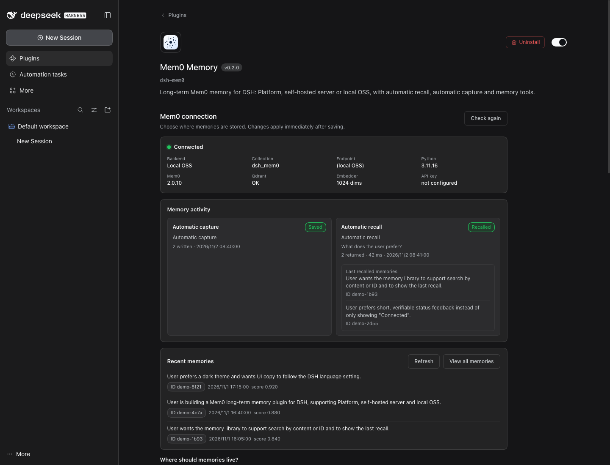
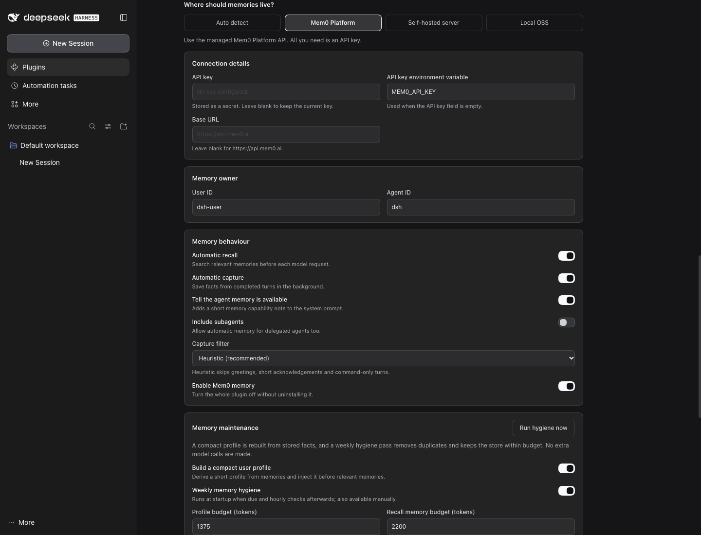
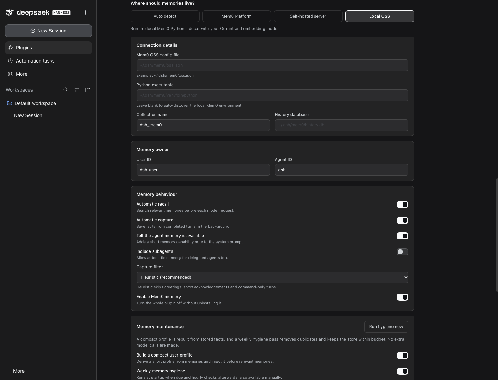
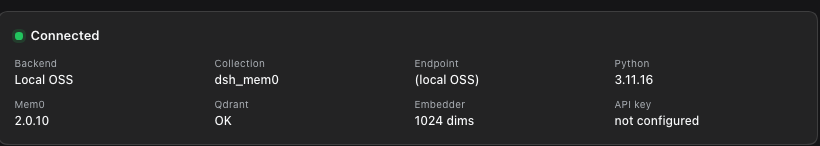
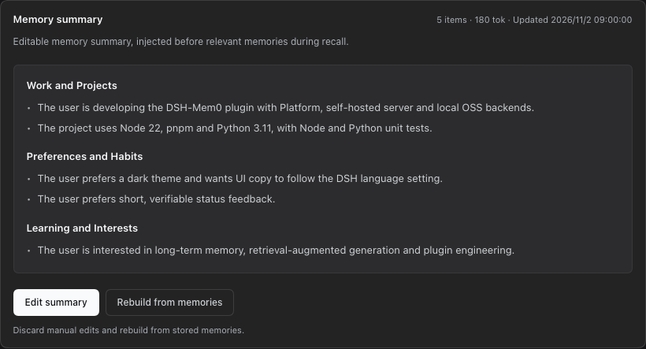
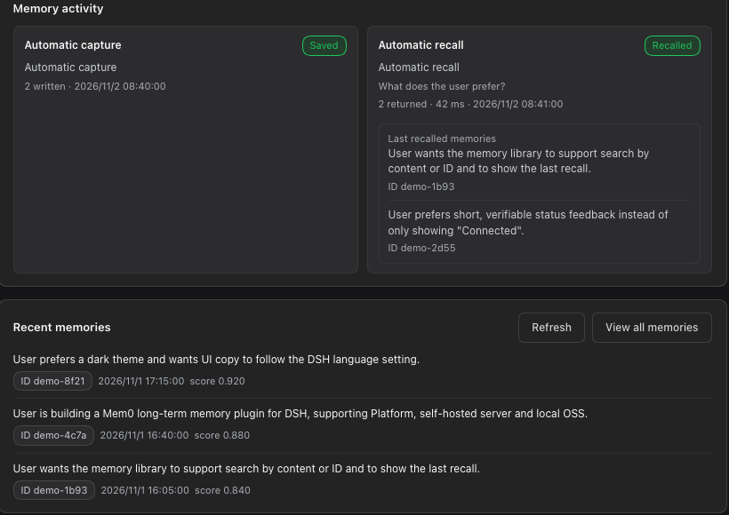
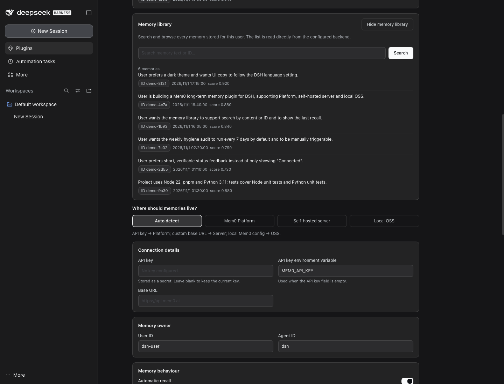
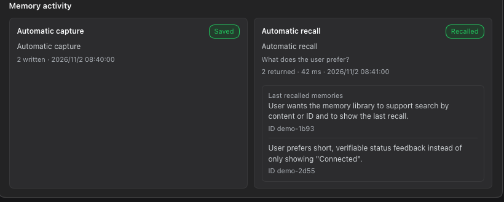
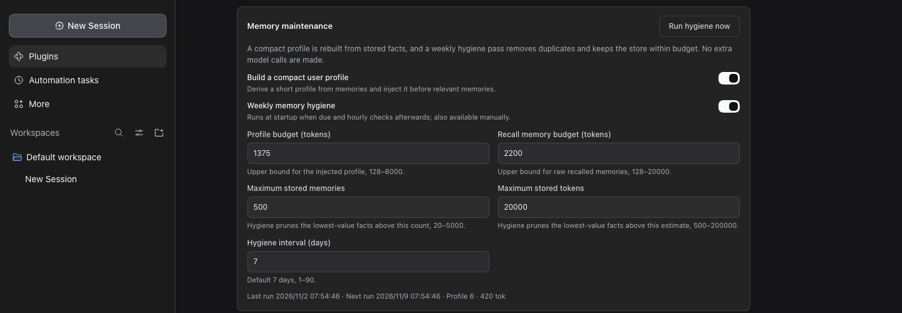
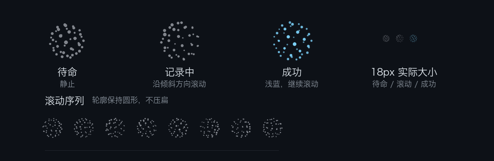

# Mem0 Memory

Long-term memory for DeepSeek Harness, powered by [Mem0](https://mem0.ai). It recalls relevant facts before each turn, saves new facts after each turn, and keeps an editable memory summary in the system prompt.

Three backends are supported:

- **Mem0 Platform**: the managed Mem0 API. Only an API key is needed; the best fit for most users.
- **Self-hosted server**: your own Mem0 REST service.
- **OSS Python sidecar**: a local Mem0 Python SDK with your own Qdrant, embedder and LLM (for example local bge-m3).

Source code, issues and release notes: <https://github.com/light-cheng/DSH-Mem0>

## Features

- **Automatic recall**: on every turn, the latest real user message is used to search for related memories, which are injected into the model context as a `<mem0-relevant-memories>` data block. A failed or timed-out search never blocks the model request.
- **Automatic capture and filtering**: after a turn completes normally, the turn's user messages and the final assistant reply (not the narration between tool calls) are sent to Mem0 for fact extraction and storage, so long tool-heavy turns are still captured. Interrupted, failed or rejected turns are not saved. The default heuristic filter skips greetings, short acknowledgements and command-only turns.
- **Editable memory summary**: a structured summary built from stored memories, ranked by pinned/importance metadata and then freshness (newer first, decaying over about 90 days; text length only breaks ties), injected before the recalled memories. It has its own token budget, can be edited in the settings page, and can be read or rewritten by the agent with `mem0_profile_get` / `mem0_profile_update` / `mem0_profile_reset`. Manual edits survive weekly hygiene; **Rebuild from memories** restores the generated version.
- **Memory budgets and weekly hygiene**: recalled memories and the summary each have a token budget. A hygiene pass runs every 7 days by default to remove duplicates and the oldest over-budget memories. It only deletes memories written by this plugin (`metadata.source: "dsh"`), and automatic passes only preview until you confirm one manual run in the settings page.
- **Explicit tools**: `mem0_search`, `mem0_add`, `mem0_get`, `mem0_update`, `mem0_delete`, `mem0_status`, plus `mem0_profile_get`, `mem0_profile_update`, `mem0_profile_reset` for the memory summary.
- **Visible memory activity**: the settings page shows the last automatic capture and recall, the most recently written memories (text, ID, time), a searchable **Memory library**, and **Last recalled memories** with the texts the latest recall actually matched.
- **Status globe**: a dot-matrix globe below the chat composer rolls while capture or recall runs, turns light blue on success and red on failure.
- **Bilingual UI**: labels follow DSH's language setting. With `translateMemories` on (off by default), memory text is also translated into the page language with the current DSH model.
- **Security boundaries**: the OSS sidecar listens only on a random `127.0.0.1` port with a random token; common secrets are redacted before capture and recall; `mem0_status` never returns the API key.

## Settings page

Open **Plugins** in the DSH sidebar, then **Mem0 Memory** under **Installed plugins**. Choose a backend, check the live connection status and save settings right on the plugin's page.



Each backend has its own fields and guidance:





**Test connection** runs the same read-only health check as `mem0_status`: current backend, collection, and Python/Mem0/Qdrant/embedder status. It never shows the API key. On success the status card shows a green **Connected** chip.



**Memory summary** shows the editable summary by section. Use **Edit summary** to change it and **Rebuild from memories** to regenerate it from the store.



**Memory activity** records the latest automatic capture and recall; **Recent memories** reads the backend directly, so you can see whether capture actually worked. **Recent failures** keeps the last 20 failures with their cause (timeout, connection, auth or quota, circuit-breaker skip, other), across restarts. Under the chat input, **Memory failed** means a capture or recall failed and **Status unavailable** means DSH could not read the plugin's status; hover or click either to see the cause.



**View all memories** opens the **Memory library**, where every memory stored for the current user can be searched by content or ID. **Last recalled memories** shows the texts, IDs, count and latency of the latest automatic recall.





**Memory maintenance** sets the summary budget, recall budget, storage limits and hygiene interval, and shows the last and next hygiene run and the latest report. **Run hygiene now** first computes a preview and asks you to confirm "delete N memories".



The globe below the chat composer stays still while idle, rolls while recording, and turns light blue on success. It stays still when the system asks for reduced motion.




## Memory maintenance

Three budgets are kept apart:

- **Memory summary budget**: upper bound for the `<mem0-user-profile>` block, 1375 tokens by default.
- **Recall memory budget**: upper bound for the `<mem0-relevant-memories>` block, 2200 tokens by default.
- **Storage limits**: maximum number of memories (default 500) and estimated tokens (default 20000) kept after hygiene.

Hygiene runs every 7 days by default (1–90 days). It runs once at startup if due, then checks hourly. It deletes only duplicates and the oldest over-budget memories, and only among memories this plugin wrote (`metadata.source: "dsh"`, set by automatic capture and `mem0_add`). Memories written by other apps under the same `userId` are read into the summary but never deleted and do not count toward the storage limits. Until you confirm one manual **Run hygiene now**, automatic passes are dry runs: their report is marked "Preview, nothing deleted". Each pass deletes at most 100 memories. The summary and hygiene history are stored in the DSH profile's `dsh-mem0/maintenance.json`, not in Mem0.

The generated summary is built locally without extra model calls. Section headings follow the dominant language of the memories.

To keep DeepSeek's prefix cache warm, the summary is a system-prompt section (`plugin:dsh-mem0:profile`) that changes only when the stored summary changes. The per-turn recall block is a runtime context (`mem0:recall`) that DSH appends next to the latest user message, so earlier history is never rewritten.

## Working with context plugins

Context-management plugins (for example dsh-strata) can recognise what this plugin injects by these stable names and tags:

| What | Where it goes | Name | Text starts / ends with | Changes |
|---|---|---|---|---|
| Memory summary | system-prompt section | `plugin:dsh-mem0:profile` | `<mem0-user-profile>` … `</mem0-user-profile>` | only when the stored summary changes |
| Recalled memories | runtime context, always last | `mem0:recall` | `<mem0-relevant-memories>` … `</mem0-relevant-memories>` | usually every turn |

- DSH joins all runtime contexts into one snapshot and appends it to history as a user-role message (`source.kind: "runtime-context"`) whenever the joined text changes. Older snapshots hold stale recall blocks; a context plugin can trim or drop them, because Mem0 can recall again at any time. Leave the newest snapshot alone.
- Automatic capture only reads `user/message` events whose source is `user`, so recall blocks are never saved back into Mem0.
- Capture uses the text buffered from the turn's events, not session history or tool output, so trimming history does not change what is saved.

### dsh-strata

With [dsh-strata](https://www.npmjs.com/package/@lightcheng/dsh-strata) installed:

- **Shared recall budget.** Before each recall, this plugin asks Strata's `strataBudget` service how many tokens the recall block may use: the full `memoryBudgetTokens` normally, half once the context passes 65% (`tight`), and at most 512 tokens past 75% (`critical`). An allowance of 0 skips recall for that turn. Without Strata, or if the service fails, recall uses `memoryBudgetTokens`. The memory summary is never shrunk per turn. `mem0_status` and the Memory activity card show the last budget, e.g. `recall budget 1100 / 2200 (strata: tight)`.
- **Fold summaries as a memory source (`captureStrataFolds`, off by default).** With it and automatic capture on, each tier-1 fold summary Strata lands for a main-agent session (`strata/fold-landed`) is redacted and saved with metadata `source: "dsh"`, `via: "dsh-strata"`. These are turns already captured, saved again as a cleaner summary; Mem0 merges repeated facts.

## Configuration

Configuring in the settings page is recommended. You can also edit the profile's `cordis.patch.yml`:

```yaml
- id: dsh-mem0
  name: dsh-mem0
  config:
    backend: platform
    userId: "your-user-id"
    agentId: "dsh"
```

### Mem0 Platform (recommended)

Store the API key in DSH credentials (for example `~/.dsh/.credentials.yaml`) so it never appears in the profile config:

```yaml
version: 1
refs:
  MEM0_API_KEY: m0-your-key
```

and refer to it by name (this is the default):

```yaml
config:
  backend: platform
  apiKeyEnv: MEM0_API_KEY
```

Lookup order: a literal `apiKey` in the config, then DSH credentials for the name in `apiKeyEnv` (the store first, then the launching environment and `.env` files), then the environment variable of that name. A rotated key applies on the next request without a restart. `mem0_status` reports where the key came from (`config`, `credentials`, `env` or `none`), never the key.

> **`backend: auto`:** if `MEM0_API_KEY` (or the name in `apiKeyEnv`) is in DSH credentials or DSH's environment, `auto` picks the cloud Platform even when a local OSS config exists. The settings page and `mem0_status` show the "backend choice". Set `backend` explicitly to force one.

### Self-hosted Mem0 server

```yaml
config:
  backend: server
  baseUrl: "http://127.0.0.1:8888"
  authType: apiKey
  apiKey: "your-server-key"
  userId: "your-user-id"
```

`authType` supports `apiKey` (`X-API-Key`), `bearer`, `token` and `none` (for local services with `AUTH_DISABLED=true`).

### OSS Python sidecar (local Qdrant / bge-m3)

Prepare a Mem0 OSS config file, for example `~/.dsh/mem0/oss.json` (see the [example config](https://github.com/light-cheng/DSH-Mem0/blob/main/examples/oss-config.example.json)), and a Python environment:

```bash
python3 -m venv ~/.dsh/mem0/venv
~/.dsh/mem0/venv/bin/pip install "mem0ai>=2.0.10,<3" qdrant-client openai
```

```yaml
config:
  backend: oss
  pythonPath: "~/.dsh/mem0/venv/bin/python"
  mem0ConfigPath: "~/.dsh/mem0/oss.json"
  collectionName: "dsh_mem0"
  userId: "your-user-id"
  # Optional: extra environment variables the sidecar may see
  # sidecarEnv: ["MY_GATEWAY_API_KEY"]
```

The plugin never installs Python or Qdrant on its own and does not modify the system Python; the settings page shows connection errors instead.

The sidecar reads `oss.llm`, `oss.embedder` and `oss.vector_store` from `mem0ConfigPath` and uses `collectionName` as its collection, so other Mem0 clients can keep their own collections.

The sidecar does not inherit DSH's whole environment. It gets `PATH`, `HOME`, locale, proxy and CA-bundle variables, Python/virtualenv/Conda variables, model-cache variables (`HF_*`, `TRANSFORMERS_*`, `TORCH_*` …) and common provider prefixes (`OPENAI_*`, `AZURE_*`, `ANTHROPIC_*`, `GOOGLE_*`, `GEMINI_*`, `AWS_*`, `OLLAMA_*`, `DEEPSEEK_*`, `GROQ_*`, `TOGETHER_*`, `MISTRAL_*`, `LITELLM_*`, `QDRANT_*` and similar). `MEM0_API_KEY` and `OPENROUTER_API_KEY` are not passed. List any other variable your providers need in `sidecarEnv`.

When `mem0ConfigPath` or `pythonPath` is not set, the plugin looks in `~/.dsh/mem0/` first, then (read-only) in the legacy `~/.hermes/mem0.json` and `~/.hermes/hermes-agent/venv/bin/python`.

While the sidecar is starting (first use, or after a crash), automatic recall skips that turn instead of waiting; tools and capture wait for it (up to 15 s).

### All options

| Field | Default | Description |
|---|---|---|
| `backend` | `auto` | `auto` / `platform` / `server` / `oss` |
| `apiKey` | empty | Platform or server API key (prefer DSH credentials, see `apiKeyEnv`) |
| `apiKeyEnv` | `MEM0_API_KEY` | Name of the API key in DSH credentials, or of the environment variable |
| `baseUrl` | Platform: `https://api.mem0.ai`; server: `http://127.0.0.1:8888` | API endpoint |
| `authType` | `apiKey` (Platform is fixed to token) | `apiKey` / `bearer` / `token` / `none` |
| `pythonPath` | auto-discovered | OSS-mode Python interpreter |
| `mem0ConfigPath` | `~/.dsh/mem0/oss.json` | OSS-mode Mem0 config file |
| `collectionName` | `dsh_mem0` | OSS-mode Qdrant collection |
| `historyDbPath` | `~/.dsh/mem0/history.db` | OSS sidecar local history database |
| `userId` | `dsh-user` | Memory owner |
| `agentId` | `dsh` | Agent identifier attached on writes; recall filters by `userId`, not `agentId` |
| `autoRecall` | `true` | Automatic recall |
| `autoCapture` | `true` | Automatically save completed turns |
| `announceToAgent` | `true` | Announce memory capability to the model |
| `includeSubagents` | `false` | Enable automatic memory for subagents |
| `captureMaxChars` | `450` | Per-message truncation limit for automatic capture |
| `captureFilter` | `heuristic` | `heuristic` skips low-value turns; `off` saves every completed turn |
| `recallTopK` | `5` | Number of automatic recall results |
| `memoryBudgetTokens` | `2200` | Token limit for the recalled-memory block, 128–20000 |
| `profileEnabled` | `true` | Generate and inject the memory summary |
| `profileBudgetTokens` | `1375` | Token budget for the memory summary |
| `storeMaxMemories` | `500` | Maximum memories kept after hygiene |
| `storeMaxTokens` | `20000` | Estimated token limit for memories kept after hygiene |
| `hygieneEnabled` | `true` | Enable memory hygiene |
| `hygieneIntervalDays` | `7` | Hygiene interval in days, 1–90 |
| `translateMemories` | `false` | Translate memory text on the settings page with the DSH default model (sends memory text to that model) |
| `captureStrataFolds` | `false` | Also save dsh-strata's tier-1 fold summaries (needs `autoCapture` and dsh-strata) |
| `timeoutMs` | `30000` | Timeout for each backend request (tools, listing, hygiene) |
| `recallTimeoutMs` | `3000` | Timeout for automatic recall, 100–60000; on timeout the turn continues without recalled memories |
| `addTimeoutMs` | `120000` | Timeout for storing memories (capture and `mem0_add`), 1000–600000 |
| `sidecarEnv` | `[]` | OSS: extra environment variable names passed to the sidecar |
| `enabled` | `true` | Master switch |

Saved changes apply on their own: the plugin restarts itself when new values are committed, so no DSH restart is needed.

## Tools

| Tool | Purpose |
|---|---|
| `mem0_search` | Semantic search; returns `[mem0:<id>]` and relevance |
| `mem0_add` | Store one persistent fact verbatim (`infer:false`) |
| `mem0_get` | Read by ID, or list for the configured user; ownership is checked |
| `mem0_update` | Update text by ID; ownership is checked |
| `mem0_delete` | Delete one memory by ID; no bulk delete or reset |
| `mem0_status` | Check backend connection and storage status |
| `mem0_profile_get` | Read the editable memory summary |
| `mem0_profile_update` | Replace the memory summary text; empty clears it |
| `mem0_profile_reset` | Rebuild the memory summary from stored facts |

## Privacy and data

**What leaves this machine**

| Backend / feature | Sent | To |
|---|---|---|
| Platform | Captured conversation text (user and assistant messages, redacted and truncated; with `captureStrataFolds`, also redacted dsh-strata fold summaries), recall queries, `userId`/`agentId`, metadata `source`, `channel`, `session_id` | `https://api.mem0.ai` (or your `baseUrl`) |
| Server | The same | Your self-hosted Mem0 server |
| OSS | The same, via a loopback-only sidecar | The LLM, embedder and vector store in your `oss.json`; if those are cloud APIs, the text goes there |
| Memory translation (`translateMemories`, off by default) | Memory text shown on the settings page | DSH's current default model, which may be a cloud model |

The working directory is not sent.

**What is stored locally**

- `<DSH profile>/dsh-mem0/maintenance.json` (mode 0600): the memory summary and hygiene reports (memory IDs, counts and reasons only).
- `<DSH profile>/dsh-mem0/failures.json` (mode 0600): the last 20 failures, redacted (no keys, memory text or home paths).
- `<DSH profile>/dsh-mem0/translation-cache.json` (mode 0600, only when translation is on): memory text and its translation. Delete the file to clear it.
- OSS mode: `historyDbPath` and the Qdrant data of your OSS setup.

**Other notes**

- `autoCapture` is on by default; set it to `false` to stop automatic saving. Common secrets (API keys such as `sk-`, `tvly-`, `AIza…`, JWTs, `Bearer` tokens, passwords in URLs, `password=` phrasing, private keys) are redacted before writing, but regular expressions are not a substitute for real secret management.
- Hygiene deletion is real; there is no recycle bin. For full manual control set `hygieneEnabled: false`.
- In Platform and server mode, memories are kept by that service; read its privacy and retention policy.

## Links

- Source and issues: <https://github.com/light-cheng/DSH-Mem0>
- Release notes: <https://github.com/light-cheng/DSH-Mem0/blob/main/RELEASE.md>
- License: MIT
