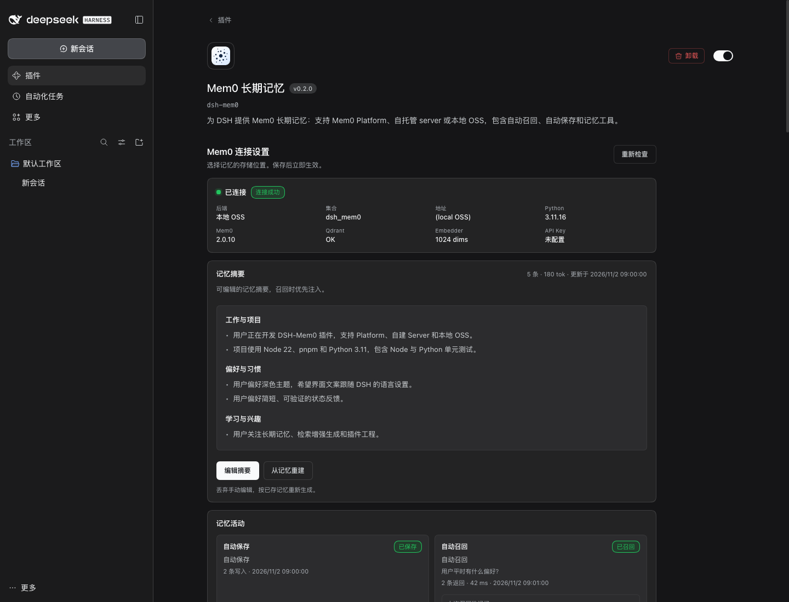
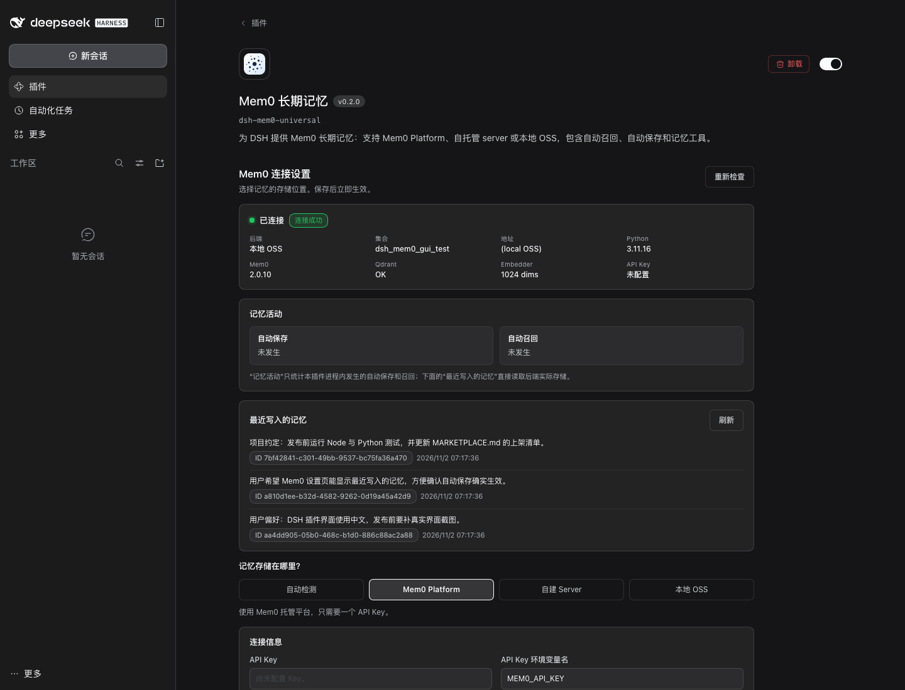
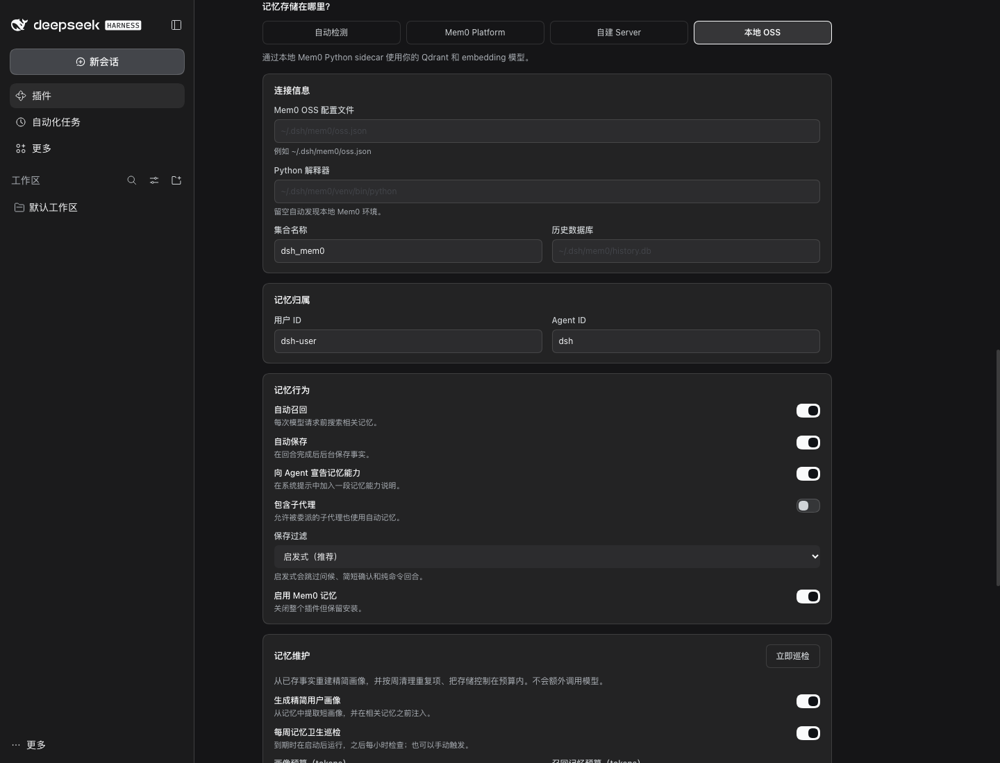
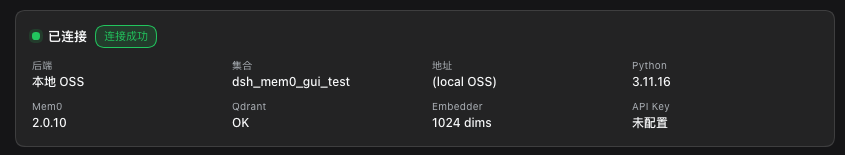
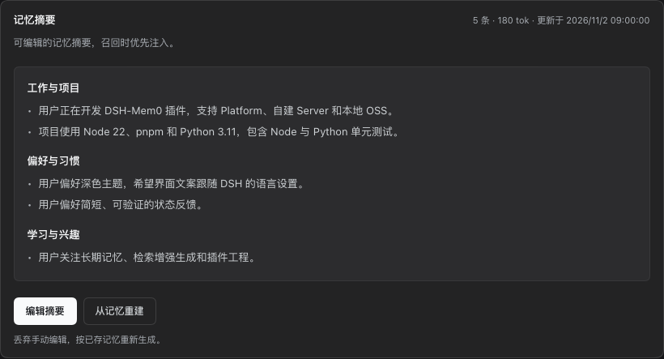
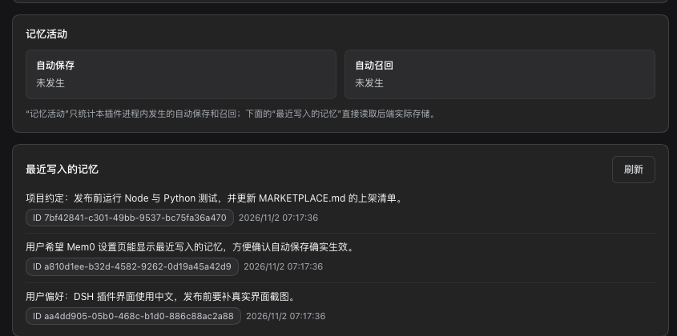
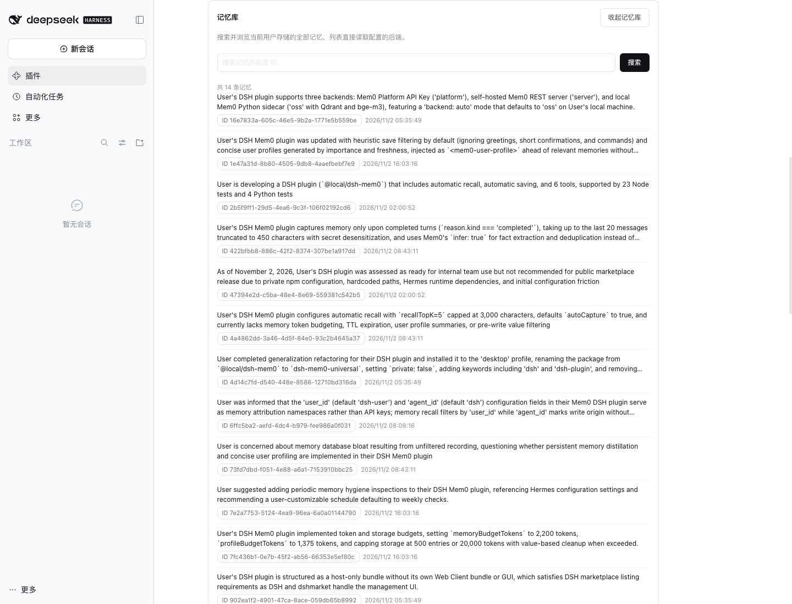
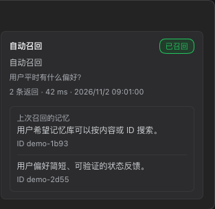
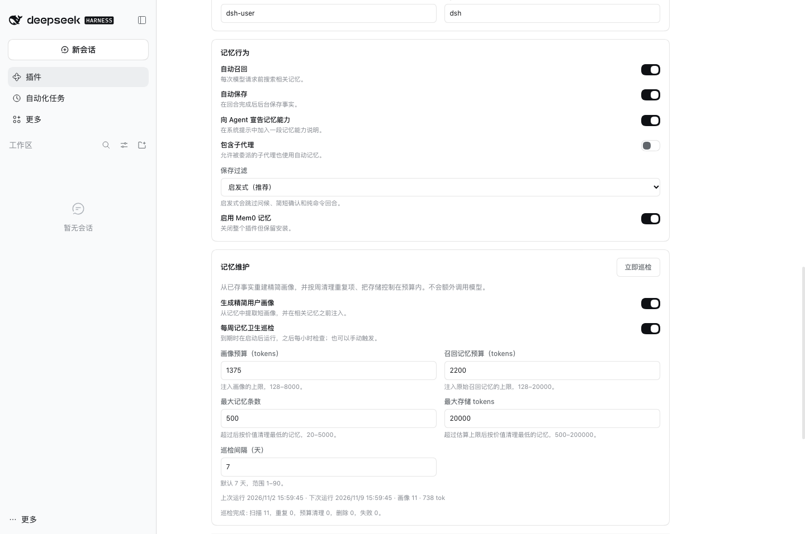
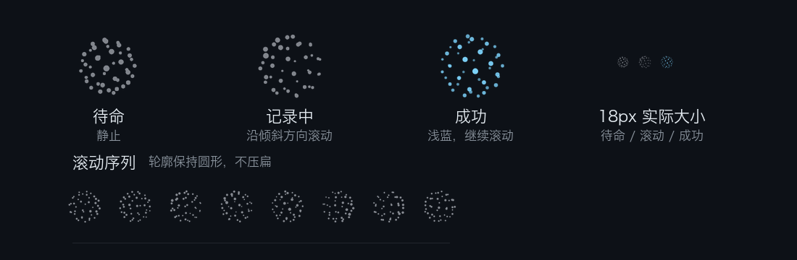

# Mem0 长期记忆

为 DeepSeek Harness 提供由 [Mem0](https://mem0.ai) 驱动的长期记忆：每轮开始前召回相关事实，每轮结束后保存新事实，并在系统提示词里维护一份可编辑的记忆摘要。

支持三种后端：

- **Mem0 Platform**：Mem0 托管 API，只需 API Key，适合大多数用户。
- **自托管 server**：连接你自建的 Mem0 REST 服务。
- **OSS Python sidecar**：使用本地 Mem0 Python SDK，配合你自己的 Qdrant、embedder 和 LLM（例如本地 bge-m3）。

源码、问题反馈和发布说明：<https://github.com/light-cheng/DSH-Mem0>

## 能力

- **自动召回**：每个回合用最近一条真实用户消息搜索相关记忆，以 `<mem0-relevant-memories>` 数据块注入模型上下文；失败或超时不会阻塞模型请求。
- **自动保存与过滤**：回合正常完成后，把本轮的用户消息和助手的最终回复（不含工具调用之间的中间叙述）交给 Mem0 抽取事实并写入，工具调用很多的长回合也会被保存；中断、失败、被拒绝的回合不保存。默认的启发式过滤会跳过问候、简短确认和纯命令回合。
- **可编辑的记忆摘要**：从已存记忆中按置顶/重要度元数据、再按新鲜度（越新越靠前，约 90 天衰减；文本长度只用于平局判定）生成结构化摘要，在召回记忆之前注入。它有独立的 token 预算，可以在设置页直接编辑，也可以由 agent 通过 `mem0_profile_get` / `mem0_profile_update` / `mem0_profile_reset` 读取或改写。手动编辑不会被周巡检覆盖；「从记忆重建」可恢复自动生成版本。
- **记忆预算与周巡检**：召回记忆和记忆摘要各有 token 预算；默认每 7 天巡检一次，去重并清理超预算中最旧的记忆。巡检只删除本插件写入的记忆（`metadata.source: "dsh"`），并且在你于设置页确认一次手动巡检之前，自动巡检只出预览、不删除。
- **显式工具**：`mem0_search`、`mem0_add`、`mem0_get`、`mem0_update`、`mem0_delete`、`mem0_status`，以及记忆摘要的 `mem0_profile_get`、`mem0_profile_update`、`mem0_profile_reset`。
- **看得见的记忆活动**：设置页显示最近一次自动保存和自动召回、最近写入的记忆（文本、ID、时间）、可搜索的「记忆库」，以及「上次召回的记忆」——最近一次召回实际命中的文本。
- **状态地球仪**：对话输入框下方的点阵地球仪在保存或召回时滚动，成功变浅蓝，失败变红。
- **中英双语界面**：文案跟随 DSH 的语言设置；开启 `translateMemories`（默认关闭）后，记忆文本也会用当前 DSH 模型翻译成页面语言。
- **安全边界**：OSS sidecar 只监听 `127.0.0.1` 的随机端口并使用随机 token；保存和召回前做常见密钥脱敏；`mem0_status` 不输出 API Key。

## 设置页

打开 DSH 侧栏的「插件」，在「已安装插件」中打开「Mem0 长期记忆」，即可在插件页面里选择后端、查看实时连接状态并保存设置。



每种后端都有对应的字段和引导：





「测试连接」调用与 `mem0_status` 相同的只读健康检查，显示当前后端、集合和 Python/Mem0/Qdrant/Embedder 状态，不显示 API Key。成功时状态卡会显示绿色的「连接成功」。



「记忆摘要」按主题分节显示可编辑的摘要；点「编辑摘要」修改，点「从记忆重建」按已存记忆重新生成。



「记忆活动」记录最近一次自动保存和自动召回的结果；「最近写入的记忆」直接读取后端，可以确认自动保存是否真的生效。「最近失败」保留最近 20 次失败及原因（超时、连接失败、认证或额度、熔断跳过、其他）和出错的组件（LLM、向量模型、向量库、OSS 进程、Mem0 API），重启后仍在。输入框下显示「记忆失败」表示自动保存或召回失败，「状态读取失败」表示 DSH 读不到插件状态；悬停或点击即可看到原因。



「查看全部记忆」打开「记忆库」，可按内容或 ID 搜索当前用户的全部记忆；「上次召回的记忆」显示最近一次自动召回命中的文本、ID、条数和延迟。





「记忆维护」可以调整记忆摘要预算、召回预算、存储上限和巡检间隔，并查看上次/下次巡检时间和最近一次巡检报告。「立即巡检」会先生成预览，提示「将删除 N 条」，确认后才删除。



对话输入框下方的点阵地球仪待命时静止，记录中滚动，成功后变成浅蓝色；系统开启「减少动态效果」时保持静止。




## 记忆维护

三个预算互相独立：

- **记忆摘要预算**：`<mem0-user-profile>` 数据块的上限，默认 1375 tokens。
- **召回记忆预算**：`<mem0-relevant-memories>` 数据块的上限，默认 2200 tokens。
- **存储上限**：巡检后保留的最大记忆条数（默认 500）和估算 tokens（默认 20000）。

巡检默认每 7 天一次（可设 1–90 天）；插件启动时若已到期会跑一次，之后每小时检查。巡检只删除重复项和超预算中最旧的记忆，并且只在本插件写入的记忆里挑选（自动保存和 `mem0_add` 会写入 `metadata.source: "dsh"`）。同一 `userId` 下其他应用写入的记忆会参与摘要，但绝不删除，也不计入存储上限。在你确认过一次手动「立即巡检」之前，自动巡检都是预览，报告标明「预览，未删除」。每次巡检最多删除 100 条。记忆摘要和巡检历史保存在 DSH profile 的 `dsh-mem0/maintenance.json`，不写回 Mem0。

自动生成的记忆摘要在本地生成，不额外调用模型；分节标题跟随记忆的主要语言。

为了让 DeepSeek 的前缀缓存持续命中，记忆摘要作为系统提示词分段（`plugin:dsh-mem0:profile`）注入，只在已保存的摘要变化时才变；每轮变化的召回块作为运行时上下文（`mem0:recall`），由 DSH 追加在最新一条用户消息旁边，不会改写之前的历史。

## 与上下文插件配合

上下文管理插件（例如 dsh-strata）可以通过下面这些稳定的名字和标记识别本插件注入的内容：

| 内容 | 放在哪里 | 名字 | 文本开头 / 结尾 | 变化频率 |
|---|---|---|---|---|
| 记忆摘要 | 系统提示段 | `plugin:dsh-mem0:profile` | `<mem0-user-profile>` … `</mem0-user-profile>` | 只在已存摘要变化时 |
| 召回的记忆 | 运行时上下文，总在最后 | `mem0:recall` | `<mem0-relevant-memories>` … `</mem0-relevant-memories>` | 通常每轮都变 |

- DSH 把所有运行时上下文拼成一个快照；拼接后的文本变化时，把它作为 user 角色消息（`source.kind: "runtime-context"`）追加到历史。旧快照里的召回块已经过时，上下文插件可以直接裁掉或丢弃，因为 Mem0 随时可以重新召回；最新的快照不要动。
- 自动保存只读取来源为 `user` 的 `user/message` 事件，召回块不会被写回 Mem0。
- 自动保存用的是本轮事件里缓存的文本，不读会话历史和工具输出，所以裁剪历史不会改变保存的内容。

### dsh-strata

同时安装 [dsh-strata](https://www.npmjs.com/package/@lightcheng/dsh-strata) 时：

- **共用召回预算。** 每次召回前，本插件向 Strata 的 `strataBudget` 服务询问本轮召回块最多能用多少 token：平时是完整的 `memoryBudgetTokens`；上下文超过 65%（`tight`）时减半；超过 75%（`critical`）时最多 512。额度为 0 时本轮不召回。没装 Strata 或服务出错时，照旧使用 `memoryBudgetTokens`。记忆摘要不按轮缩减。`mem0_status` 和「记忆活动」卡片会显示上一次的预算，例如 `recall budget 1100 / 2200 (strata: tight)`。
- **折叠摘要作为记忆来源（`captureStrataFolds`，默认关闭）。** 打开它并开启自动保存时，Strata 为主代理会话落地的每份一级折叠摘要（`strata/fold-landed`）会脱敏后写入，metadata 为 `source: "dsh"`、`via: "dsh-strata"`。这些回合已经保存过一次，这里是更干净的第二份摘要；重复的事实由 Mem0 合并。

## 配置

推荐在设置页里配置；也可以手写 profile 的 `cordis.patch.yml`：

```yaml
- id: dsh-mem0
  name: dsh-mem0
  config:
    backend: platform
    userId: "your-user-id"
    agentId: "dsh"
```

### Mem0 Platform（推荐）

把 API Key 存到 DSH 凭据里（例如 `~/.dsh/.credentials.yaml`），这样它不会出现在 profile 配置中：

```yaml
version: 1
refs:
  MEM0_API_KEY: m0-your-key
```

然后按名字引用（这也是默认值）：

```yaml
config:
  backend: platform
  apiKeyEnv: MEM0_API_KEY
```

查找顺序：配置里的 `apiKey` → DSH 凭据里 `apiKeyEnv` 指定的名字（先查凭据文件，再查启动环境和 `.env` 文件）→ 同名环境变量。更换 Key 后下一次请求就会生效，不用重启。`mem0_status` 会显示 Key 的来源（`config`、`credentials`、`env` 或 `none`），不显示 Key 本身。

> **关于 `backend: auto`：** 只要 DSH 凭据或 DSH 的环境变量里有 `MEM0_API_KEY`（或 `apiKeyEnv` 指定的名字），`auto` 就会选择云端 Platform，即使本地有 OSS 配置。设置页和 `mem0_status` 会显示「后端选择依据」。想用特定后端请明确设置 `backend`。

### 自托管 Mem0 server

```yaml
config:
  backend: server
  baseUrl: "http://127.0.0.1:8888"
  authType: apiKey
  apiKey: "your-server-key"
  userId: "your-user-id"
```

`authType` 支持 `apiKey`（`X-API-Key`）、`bearer`、`token` 和 `none`（`AUTH_DISABLED=true` 的本地服务）。

### OSS Python sidecar（本地 Qdrant / bge-m3）

先准备 Mem0 OSS 配置文件，例如 `~/.dsh/mem0/oss.json`（格式见[示例配置](https://github.com/light-cheng/DSH-Mem0/blob/main/examples/oss-config.example.json)），以及 Python 环境：

```bash
python3 -m venv ~/.dsh/mem0/venv
~/.dsh/mem0/venv/bin/pip install "mem0ai>=2.0.10,<3" qdrant-client openai
```

```yaml
config:
  backend: oss
  pythonPath: "~/.dsh/mem0/venv/bin/python"
  mem0ConfigPath: "~/.dsh/mem0/oss.json"
  collectionName: "dsh_mem0"
  userId: "your-user-id"
  # 可选：允许 sidecar 额外看到的环境变量
  # sidecarEnv: ["MY_GATEWAY_API_KEY"]
```

插件不会自行安装 Python 或 Qdrant，也不会修改系统 Python；环境有问题时设置页会显示连接错误。

sidecar 读取 `mem0ConfigPath` 中的 `oss.llm`、`oss.embedder`、`oss.vector_store`，并使用 `collectionName` 作为集合名，其他 Mem0 客户端可以继续用自己的集合。

sidecar 不继承 DSH 的全部环境变量，只拿到：`PATH`、`HOME`、语言区域、代理和 CA 证书变量，Python/virtualenv/Conda 变量，模型缓存变量（`HF_*`、`TRANSFORMERS_*`、`TORCH_*` 等），以及常见服务商前缀（`OPENAI_*`、`AZURE_*`、`ANTHROPIC_*`、`GOOGLE_*`、`GEMINI_*`、`AWS_*`、`OLLAMA_*`、`DEEPSEEK_*`、`GROQ_*`、`TOGETHER_*`、`MISTRAL_*`、`LITELLM_*`、`QDRANT_*` 等）。`MEM0_API_KEY` 和 `OPENROUTER_API_KEY` 不会传过去。服务商需要的其他变量请写进 `sidecarEnv`。

没有设置 `mem0ConfigPath` 或 `pythonPath` 时，插件先找 `~/.dsh/mem0/`，再（只读地）检查旧位置 `~/.hermes/mem0.json` 和 `~/.hermes/hermes-agent/venv/bin/python`。

sidecar 还在启动时（第一次使用或崩溃后），自动召回会跳过这一轮、不等待；工具调用和自动保存会等它启动完成（最多 15 秒）。

**低配机器（embedding 只能用 CPU 跑）。** 让 embedding 模型常驻内存：为 Ollama 服务设置 `OLLAMA_KEEP_ALIVE=-1`（或例如 `24h`）。不设的话，空闲 5 分钟后的第一次召回要等模型冷加载（i5-13500H 上 bge-m3 约 2.5 秒，内存紧张时更久）。如果模型仍可能被卸载，把 `recallTimeoutMs` 调到 8000。抽取用云端模型时，`addTimeoutMs` 用默认的 120000 就够。用中文的话保留 bge-m3；换 embedding 模型会改变向量维度，需要换一个新的 `collectionName`。


### 全部配置项

| 字段 | 默认值 | 说明 |
|---|---|---|
| `backend` | `auto` | `auto` / `platform` / `server` / `oss` |
| `apiKey` | 空 | Platform 或 server 的 API Key（建议改用 DSH 凭据，见 `apiKeyEnv`） |
| `apiKeyEnv` | `MEM0_API_KEY` | API Key 在 DSH 凭据里的名字，或环境变量名 |
| `baseUrl` | Platform 为 `https://api.mem0.ai`，server 为 `http://127.0.0.1:8888` | API 地址 |
| `authType` | `apiKey`（Platform 固定为 token） | `apiKey` / `bearer` / `token` / `none` |
| `pythonPath` | 自动发现 | OSS 模式 Python 解释器 |
| `mem0ConfigPath` | `~/.dsh/mem0/oss.json` | OSS 模式 Mem0 配置文件 |
| `collectionName` | `dsh_mem0` | OSS 模式 Qdrant 集合 |
| `historyDbPath` | `~/.dsh/mem0/history.db` | OSS sidecar 本地历史库 |
| `userId` | `dsh-user` | 记忆归属用户 |
| `agentId` | `dsh` | 写入时附加的 agent 标识；召回只按 `userId` 过滤，不按 `agentId` |
| `autoRecall` | `true` | 自动召回 |
| `autoCapture` | `true` | 自动保存完成的回合 |
| `announceToAgent` | `true` | 向模型说明记忆能力 |
| `includeSubagents` | `false` | 是否对子代理启用自动记忆 |
| `captureMaxChars` | `450` | 自动保存时每条消息的截断上限 |
| `captureFilter` | `heuristic` | `heuristic` 跳过低价值回合；`off` 保存每个完成的回合 |
| `recallTopK` | `5` | 自动召回结果数 |
| `memoryBudgetTokens` | `2200` | 召回记忆块的 token 上限，128–20000 |
| `profileEnabled` | `true` | 是否生成并注入记忆摘要 |
| `profileBudgetTokens` | `1375` | 记忆摘要的 token 预算 |
| `storeMaxMemories` | `500` | 巡检后保留的最大记忆条数 |
| `storeMaxTokens` | `20000` | 巡检后保留记忆的估算 token 上限 |
| `hygieneEnabled` | `true` | 是否启用记忆巡检 |
| `hygieneIntervalDays` | `7` | 巡检间隔天数，1–90 |
| `translateMemories` | `false` | 用 DSH 默认模型在设置页翻译记忆（会把记忆原文发给该模型） |
| `captureStrataFolds` | `false` | 额外保存 dsh-strata 的一级折叠摘要（需要开启 `autoCapture` 并安装 dsh-strata） |
| `timeoutMs` | `30000` | 每次后端请求的超时（工具、列表、巡检） |
| `recallTimeoutMs` | `5000` | 自动召回的超时，100–60000；超时后本轮不带召回记忆继续 |
| `addTimeoutMs` | `120000` | 保存记忆（自动保存和 `mem0_add`）的超时，1000–600000 |
| `sidecarEnv` | `[]` | OSS：额外传给 sidecar 的环境变量名 |
| `enabled` | `true` | 总开关 |

保存的修改会自动生效：新配置提交后插件会自行重启，不需要重启 DSH。

## 工具

| 工具 | 用途 |
|---|---|
| `mem0_search` | 语义搜索，返回 `[mem0:<id>]` 和相关度 |
| `mem0_add` | 原样存储一条持久事实（`infer:false`） |
| `mem0_get` | 按 ID 读取，或按配置的用户列出；会校验归属 |
| `mem0_update` | 按 ID 更新文本；会校验归属 |
| `mem0_delete` | 按 ID 删除单条；不提供批量删除或重置 |
| `mem0_status` | 检查后端连接和存储状态 |
| `mem0_profile_get` | 读取可编辑的记忆摘要 |
| `mem0_profile_update` | 替换记忆摘要文本；空字符串表示清空 |
| `mem0_profile_reset` | 按已存事实重建记忆摘要 |

## 隐私与数据

**哪些数据会离开本机**

| 后端 / 功能 | 发送内容 | 发往 |
|---|---|---|
| Platform | 捕获的对话文本（用户和助手消息，已脱敏并截断；开启 `captureStrataFolds` 时还有脱敏后的 dsh-strata 折叠摘要）、召回查询、`userId`/`agentId`、元数据 `source`、`channel`、`session_id` | `https://api.mem0.ai`（或你的 `baseUrl`） |
| Server | 同上 | 你自建的 Mem0 服务器 |
| OSS | 同上，经由只监听 loopback 的 sidecar | `oss.json` 里配置的 LLM、embedder 和向量库；如果它们是云端 API，文本会发到那里 |
| 记忆翻译（`translateMemories`，默认关闭） | 设置页上显示的记忆原文 | DSH 当前默认模型，可能是云端模型 |

不会发送工作目录。

**哪些数据保存在本地**

- `<DSH profile>/dsh-mem0/maintenance.json`（权限 0600）：记忆摘要和巡检报告（只含记忆 ID、数量和原因）。
- `<DSH profile>/dsh-mem0/failures.json`（权限 0600）：最近 20 次失败，已脱敏（不含密钥、记忆正文和主目录路径）。
- `<DSH profile>/dsh-mem0/translation-cache.json`（权限 0600，仅在开启翻译时产生）：记忆原文和译文。删除该文件即可清空。
- OSS 模式：`historyDbPath` 以及你 OSS 环境里的 Qdrant 数据。

**其他说明**

- `autoCapture` 默认开启；不希望自动保存请设为 `false`。写入前会做常见密钥脱敏（`sk-`、`tvly-`、`AIza…` 等 API Key、JWT、`Bearer` 令牌、URL 里的密码、`password=` / `密码：` 写法、私钥），但正则表达式不能替代完整的密钥管理。
- 巡检删除是真实删除，没有回收站；想完全手动控制可设 `hygieneEnabled: false`。
- Platform/server 模式的记忆由对应服务保存；请阅读服务方的隐私和保留策略。

## 链接

- 源码和问题反馈：<https://github.com/light-cheng/DSH-Mem0>
- 发布说明：<https://github.com/light-cheng/DSH-Mem0/blob/main/RELEASE.md>
- 许可证：MIT
